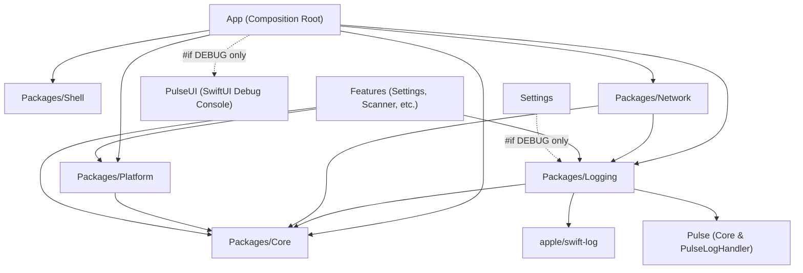

# Design Spec — Pulse Logger Architecture for iOS

- **Date:** 2026-09-19
- **Epic:** `pulse_logger`
- **Scope:** iOS Super App Template (`ios_digital_wallet`)
- **Author/Collaborators:** Antigravity AI Assistant & Engineering Lead
- **Status:** Approved (Stage 1 Gate 1 Inception)

---

## 1. Context & Motivation

In the Flutter workspace (`bloc_digital_wallet`), a centralized logging architecture was established under `packages/logger` (pure Dart, zero SDK dependency) and `packages/logger_native_bridge` (headless background logging). It introduced:
- A standardized `LogRecord` format carrying W3C Trace Context (`traceId`, `spanId`, `parentSpanId`).
- A clean abstraction layer (`ILogAppender`, `ILogManager`, `ILogger`, `D3NexusLogger`).
- Independent Module Toggles (debug mute per feature) and Appender Toggles (kill-switch per telemetry backend).
- In-app developer console inspection via `Talker`.

In our native iOS Super App template (`ios_digital_wallet`), logging is currently limited to a basic `Core.Logger` protocol forwarding to `os.Logger` via `ConsoleLogger.swift`, without structured metadata, without W3C trace propagation, and without an in-app console or network inspection tool.

The `pulse_logger` epic introduces a modern, governed, high-performance logging ecosystem for iOS native, standardizing on **`apple/swift-log`** and **`Pulse`** (`kean/Pulse` + `PulseUI`), fully aligned with the architectural patterns validated in Flutter. Furthermore, it incorporates strict **Memory Leak & Retain Cycle Prevention** across the entire lifecycle.

---

## 2. Goals & Non-Goals

### Goals
1. **Dedicated Core Logging Package (`Packages/Logging`)**:
   - Provide clean logging abstractions (`LogRecord`, `LogAppender`, `LogManager`, `LoggerProtocol`, `D3NexusLogger`) in a local SPM package.
   - Built on top of Apple's standard `apple/swift-log`.
   - Preserve `Packages/Core` as the pure dependency floor (0 external SPM dependencies, complying with `ArchTests` rule K7).
2. **W3C Trace Context & Trace Tree Re-construction**:
   - Every log record carries `traceId` (32 hex characters) and `spanId` (16 hex characters), with optional `parentSpanId`.
   - `withSpan()` method on `LoggerProtocol` creates child loggers auto-linking causal parent-child spans without retaining circular references.
   - Pure `buildTraceTree([LogRecord]) -> [TraceNode]` function to re-construct hierarchical execution flows.
   - Automatic `traceparent` header injection in network requests (`Packages/Network`).
3. **Dual Appender Telemetry Engine**:
   - **`PulseAppender`**: Structured logging to `Pulse.LoggerStore`, enabling in-app rich inspection and wireless streaming to **Pulse Pro (macOS)**.
   - **`OSLogAppender`**: High-performance Apple Unified Logging (`os.Logger`) for macOS Console.app, Xcode Console, and `sysdiagnose`.
4. **Independent Toggle Management**:
   - Module Toggle: Debug mute per module (e.g. mute `"wallet"`, `"scanner"`), respected by local debug appenders (`PulseAppender`) while never blinding production/system telemetry (`OSLogAppender`).
   - Appender Toggle: Complete kill-switch per backend (`pulse`, `oslog`).
   - Persistence via `UserDefaults` with agreed keys (`logging.module_toggles`, `logging.appender_toggles`).
5. **In-App Developer Debug UI**:
   - Instant activation via **Device Shake Gesture** or an entry in **`Features/Settings`**.
   - Full log search, regex filter, structured metadata view, and network inspection with cURL export.
   - Strictly isolated behind `#if DEBUG` with zero overhead or code leakage in Release builds.
6. **Memory Leak & Retain Cycle Guard (Shift-Left & Runtime)**:
   - Provide `trackForMemoryLeaks(_ instance: AnyObject)` test helper in `TestSupport` for teardown deallocation assertions.
   - Verify that child loggers spawned by `withSpan()` never create retain cycles with parent loggers.
   - Integrate MallocStackLogging / `leaks` verification into Tier C acceptance testing.
7. **Backward Compatibility**:
   - `D3NexusCoreLoggerAdapter` implements existing `Core.Logger`, allowing existing call sites in `Core`, `Network`, and `Platform` to function unmodified.

### Non-Goals
- Objective-C runtime inspection via FLEX or MLeaksFinder (evaluated and explicitly rejected: MLeaksFinder targets UIKit `UIViewController` swizzling and is incompatible with pure SwiftUI `NavigationStack` / `View` architectures; FLEX brings heavy Obj-C runtime baggage).
- Standalone headless IPC bridge (native iOS handles `BGTaskScheduler` directly in Swift in-process; App Extensions use App Group containers).
- Remote crash reporting backend (Datadog/Sentry SDKs can be added as future `LogAppender`s without modifying core packages).

---

## 3. Architecture & Package Structure

### 3.1 Workspace Package Graph



### 3.2 Package Responsibilities
- **`Packages/Core`**: Dependency floor. Keeps existing `Core.Logger` protocol. Zero external dependencies.
- **`Packages/Logging`**:
  - SPM dependencies: `apple/swift-log` (`1.6.2+`), `kean/Pulse` (`5.1.4+`).
  - Contains core data types, protocols, `LogManagerImpl`, `PulseAppender`, `OSLogAppender`, and `D3NexusLogger` facade.
- **`Packages/Network`**:
  - `LoggingInterceptor` updated to use `D3NexusLogger` and inject W3C `traceparent` headers into outgoing requests.
- **`Features/Settings`**:
  - Hosts Developer/Diagnostics UI section under `#if DEBUG` for toggling module/appender switches and opening `PulseUI`.
- **`App`**:
  - Composition root (`AppComposition.swift`), bootstraps `D3NexusLogger`, registers `D3NexusCoreLoggerAdapter`, sets up shake gesture.

---

## 4. Detailed Component Design

### 4.1 Data Models & Types

```swift
public enum LogLevel: Int, Comparable, Sendable, Codable {
    case verbose = 0
    case debug = 1
    case info = 2
    case warning = 3
    case error = 4

    public static func < (lhs: LogLevel, rhs: LogLevel) -> Bool {
        lhs.rawValue < rhs.rawValue
    }
}

public struct LogRecord: Sendable, Equatable, Codable {
    public let module: String
    public let level: LogLevel
    public let message: String
    public let timestamp: Date
    public let traceId: String
    public let spanId: String
    public let parentSpanId: String?
    public let errorDescription: String?
    public let metadata: [String: String]

    public init(
        module: String,
        level: LogLevel,
        message: String,
        timestamp: Date = Date(),
        traceId: String,
        spanId: String,
        parentSpanId: String? = nil,
        errorDescription: String? = nil,
        metadata: [String: String] = [:]
    ) {
        self.module = module
        self.level = level
        self.message = message
        self.timestamp = timestamp
        self.traceId = traceId
        self.spanId = spanId
        self.parentSpanId = parentSpanId
        self.errorDescription = errorDescription
        self.metadata = metadata
    }
}
```

### 4.2 Causal Trace Tree Re-construction (`buildTraceTree`)

```swift
public final class TraceNode: @unchecked Sendable {
    public let record: LogRecord
    public var children: [TraceNode]

    public init(record: LogRecord, children: [TraceNode] = []) {
        self.record = record
        self.children = children
    }
}

public func buildTraceTree(_ records: [LogRecord]) -> [TraceNode] {
    let nodes = records.map { TraceNode(record: $0) }
    var firstNodeBySpanId: [String: TraceNode] = [:]
    for node in nodes {
        if firstNodeBySpanId[node.record.spanId] == nil {
            firstNodeBySpanId[node.record.spanId] = node
        }
    }

    var roots: [TraceNode] = []
    for node in nodes {
        if let parentSpanId = node.record.parentSpanId,
           let parentNode = firstNodeBySpanId[parentSpanId] {
            parentNode.children.append(node)
        } else {
            roots.append(node)
        }
    }
    return roots
}
```

### 4.3 Appender & LogManager Protocols

```swift
public protocol LogAppender: Sendable {
    var id: String { get }
    var respectsModuleToggle: Bool { get }
    func append(_ record: LogRecord)
}

public protocol LogManager: Sendable {
    func getLogger(module: String) -> any LoggerProtocol
    func registerAppender(_ appender: any LogAppender)
    func log(_ record: LogRecord)
    func setModuleEnabled(_ module: String, enabled: Bool)
    func isModuleEnabled(_ module: String) -> Bool
    func setAppenderEnabled(_ appenderId: String, enabled: Bool)
    func isAppenderEnabled(_ appenderId: String) -> Bool
}
```

### 4.4 Logger Protocol & Facade

```swift
public protocol LoggerProtocol: Sendable {
    var traceId: String { get }
    var spanId: String { get }

    func d(_ message: String, error: (any Error)?, metadata: [String: String]?)
    func i(_ message: String, error: (any Error)?, metadata: [String: String]?)
    func w(_ message: String, error: (any Error)?, metadata: [String: String]?)
    func e(_ message: String, error: (any Error)?, metadata: [String: String]?)
    func v(_ message: String, error: (any Error)?, metadata: [String: String]?)

    func withSpan() -> any LoggerProtocol
}

public enum D3NexusLogger {
    private static let lock = NSLock()
    private static var manager: (any LogManager)?

    public static func initialize(manager: any LogManager) {
        lock.lock()
        defer { lock.unlock() }
        self.manager = manager
    }

    public static func getLogger(_ module: String) -> any LoggerProtocol {
        lock.lock()
        defer { lock.unlock() }
        guard let manager else {
            fatalError("D3NexusLogger must be initialized before calling getLogger(_:)")
        }
        return manager.getLogger(module: module)
    }

    public static func setModuleEnabled(_ module: String, enabled: Bool) {
        lock.lock()
        defer { lock.unlock() }
        manager?.setModuleEnabled(module, enabled: enabled)
    }

    public static func setAppenderEnabled(_ appenderId: String, enabled: Bool) {
        lock.lock()
        defer { lock.unlock() }
        manager?.setAppenderEnabled(appenderId, enabled: enabled)
    }
}
```

### 4.5 SwiftLog Bridge (`D3NexusLogHandler`)

```swift
import Logging

public struct D3NexusLogHandler: LogHandler {
    public var metadata: Logging.Logger.Metadata = [:]
    public var logLevel: Logging.Logger.Level = .trace
    private let label: String
    private let manager: any LogManager

    public init(label: String, manager: any LogManager) {
        self.label = label
        self.manager = manager
    }

    public subscript(metadataKey key: String) -> Logging.Logger.Metadata.Value? {
        get { metadata[key] }
        set { metadata[key] = newValue }
    }

    public func log(
        level: Logging.Logger.Level,
        message: Logging.Logger.Message,
        metadata: Logging.Logger.Metadata?,
        source: String,
        file: String,
        function: String,
        line: UInt
    ) {
        let mappedLevel = LogLevel(from: level)
        let record = LogRecord(
            module: label,
            level: mappedLevel,
            message: message.description,
            traceId: metadata?["traceId"]?.description ?? UUID().uuidString.replacingOccurrences(of: "-", with: "").lowercased(),
            spanId: metadata?["spanId"]?.description ?? String(UUID().uuidString.prefix(16)).lowercased(),
            metadata: metadata?.mapValues { $0.description } ?? [:]
        )
        manager.log(record)
    }
}
```

### 4.6 Network Telemetry & W3C Header Injection

In `Packages/Network/Sources/Network/Interceptor/LoggingInterceptor.swift`:
```swift
public struct LoggingInterceptor: Interceptor {
    private let logger: any LoggerProtocol

    public init(logger: any LoggerProtocol = D3NexusLogger.getLogger("Network")) {
        self.logger = logger
    }

    public func intercept(request: URLRequest) async throws -> URLRequest {
        var modifiedRequest = request
        let childLogger = logger.withSpan()

        // W3C Trace Context injection: 00-{traceId}-{spanId}-01
        let traceparent = "00-\(childLogger.traceId)-\(childLogger.spanId)-01"
        modifiedRequest.setValue(traceparent, forHTTPHeaderField: "traceparent")

        childLogger.d("HTTP \(request.httpMethod ?? "GET") \(request.url?.absoluteString ?? "")")
        return modifiedRequest
    }

    public func intercept(response: HTTPURLResponse, data: Data) async throws {
        let statusCode = response.statusCode
        if (200..<300).contains(statusCode) {
            logger.i("HTTP Response \(statusCode) (\(data.count) bytes)")
        } else {
            logger.e("HTTP Error \(statusCode) (\(data.count) bytes)")
        }
    }
}
```

---

## 5. Memory Leak & Retain Cycle Prevention Architecture

### 5.1 Shift-Left Test Deallocation Assertions
To prevent subtle memory leaks caused by closures or child logger chains, a standardized test helper is integrated into `TestSupport`:

```swift
import XCTest

public extension XCTestCase {
    func trackForMemoryLeaks(_ instance: AnyObject, file: StaticString = #filePath, line: UInt = #line) {
        addTeardownBlock { [weak instance] in
            XCTAssertNil(
                instance,
                "⚠️ Memory Leak Detected: \(String(describing: instance)) was not deallocated after test teardown.",
                file: file,
                line: line
            )
        }
    }
}
```
Every unit test creating `LogManagerImpl`, `LoggerImpl`, `PulseAppender`, `OSLogAppender`, and `D3NexusCoreLoggerAdapter` exercises this assertion.

### 5.2 Parent-Child Span Relationship Memory Safety
- When `logger.withSpan()` is invoked, the returned child logger holds its own copy of `traceId` and generates a new `spanId`, setting `parentSpanId` as a pure value (`String`).
- **No strong reference to the parent `LoggerImpl` instance is retained**. This eliminates any possibility of a parent-child circular retain cycle.

### 5.3 Diagnostic Profiling & CI Leak Gate
- In local development and CI runs, the test scheme enables `MallocStackLogging = Live Allocations Only`.
- Integration and UI tests in Tier C verify that deallocations occur smoothly without circular graph blocks.

---

## 6. Security & PII Redaction

Mobile Fintech applications handle strictly regulated data. All log events pass through sanitization:
1. **Header Masking**: `Authorization`, `Cookie`, `X-API-Key`, `Session-Token` headers are masked as `[REDACTED]`.
2. **Regex Pattern Redaction**: PAN credit card numbers (`\b(?:\d{4}[ -]?){3}\d{4}\b`), CVVs, PINs, OTP codes are masked before being persisted or displayed.
3. **Compile-time Isolation**: `PulseUI` and Shake gesture detection are compiled out in `#if !DEBUG` builds.

---

## 7. Testing Strategy

| Tier | Scope | Target | Key Scenarios |
| :--- | :--- | :--- | :--- |
| **Tier 1** | Unit Tests | `Packages/Logging/Tests` | • 8-case dispatch truth table (Module Toggle × Appender Toggle × `respectsModuleToggle`).<br>• W3C trace & span generation, child span parent linkage.<br>• `trackForMemoryLeaks` assertion on all instances and child spans.<br>• `buildTraceTree` hierarchy reconstruction and orphan handling.<br>• PII masking logic. |
| **Tier 2** | Component / Integration | `Packages/Network/Tests`, `App/Tests` | • Network interceptor `traceparent` header injection.<br>• `D3NexusCoreLoggerAdapter` delegating to `D3NexusLogger`.<br>• Zero retain cycle in interceptor async closures. |
| **Tier 3** | Architecture Governance | `ArchTests` | • AST verification (K1-K10 rules): `Packages/Logging` does not import features.<br>• SwiftLint and SwiftFormat clean.<br>• Memory leak check via Scheme diagnostics. |

---

## 8. Phased Rollout Plan

1. **Task 1**: Scaffold `Packages/Logging` (Data models, `LogRecord`, `buildTraceTree`, W3C trace generator, memory leak test helper, unit tests).
2. **Task 2**: Implement `LogManagerImpl`, dispatch logic, `LoggerProtocol`, `withSpan()` zero-leak child spawner, `D3NexusLogger` facade, and unit test suite.
3. **Task 3**: Integrate `apple/swift-log` and `kean/Pulse`, implement `PulseAppender`, `OSLogAppender`, and `D3NexusLogHandler` with deallocation verification.
4. **Task 4**: Implement `D3NexusCoreLoggerAdapter` and wire into `AppComposition.swift`.
5. **Task 5**: Upgrade `LoggingInterceptor` in `Packages/Network` with W3C `traceparent` header injection and weak-capture closure safety.
6. **Task 6**: Add Shake Gesture and `Features/Settings` Developer Logging UI (`PulseUI` sheet, module & appender switches) with strict `#if DEBUG` compile-time stripping.
7. **Task 7**: Quality check gate (Tier 1-3 tests, `ArchTests`, SwiftLint, SwiftFormat, and Memory Leak gate).
