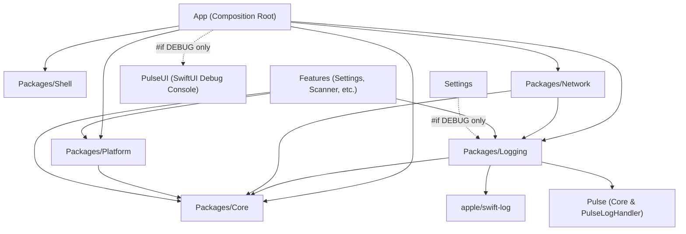

# Tài liệu Thiết kế — Kiến trúc Pulse Logger cho iOS

- **Ngày tạo:** 2026-09-19
- **Epic:** `pulse_logger`
- **Phạm vi:** Template iOS Super App (`ios_digital_wallet`)
- **Tác giả / Phối hợp:** Antigravity AI Assistant & Engineering Lead
- **Trạng thái:** Đã duyệt (Stage 1 Gate 1 Inception)

> [!IMPORTANT]
> **Rà soát Stage 2 (2026-09-19): các đoạn code Swift bên dưới đã bị thay thế.**
> Phạm vi và kiến trúc được duyệt ở Gate 1 vẫn giữ nguyên. Tuy nhiên một số snippet minh hoạ được
> viết dựa trên API và giả định không tồn tại trong repo này: tên module đụng với `apple/swift-log`,
> protocol interceptor được vẽ không phải protocol mà `Packages/Network` khai báo, bộ sinh `spanId`
> không tạo ra hex, và `buildTraceTree` có thể dựng thành cycle. Từng điểm đã được hiệu chỉnh kèm
> bằng chứng trong **[`pulse_logger.vi.md`](pulse_logger.vi.md) §3 — Sai lệch so với Spec gốc**.
> Hãy đọc mục đó trước khi hiện thực bất cứ thứ gì từ tài liệu này.


---

## 1. Bối cảnh & Động lực

Tại repository Flutter (`bloc_digital_wallet`), một kiến trúc logging tập trung đã được chuẩn hóa qua `packages/logger` (thuần Dart, không phụ thuộc SDK bên thứ ba) và `packages/logger_native_bridge` (logging chế độ headless khi chạy background). Kiến trúc này mang lại:
- Chuẩn định dạng `LogRecord` mang thông tin W3C Trace Context (`traceId`, `spanId`, `parentSpanId`).
- Lớp trừu tượng hoá sạch sẽ (`ILogAppender`, `ILogManager`, `ILogger`, `D3NexusLogger`).
- Tách biệt kiểm soát Module Toggles (mute debug cho từng tính năng) và Appender Toggles (kill-switch cho từng backend telemetry).
- Màn hình giao diện debug trực tiếp trong app qua `Talker`.

Trong template iOS Super App (`ios_digital_wallet`), hệ thống logging hiện tại chỉ dừng ở mức protocol `Core.Logger` tối giản chuyển tiếp sang `os.Logger` qua `ConsoleLogger.swift`, chưa có metadata có cấu trúc, chưa có W3C trace propagation, và chưa có công cụ xem log hay kiểm tra network trực tiếp trên thiết bị.

Epic `pulse_logger` xây dựng một hệ sinh thái logging hiện đại, chuẩn mực, hiệu năng cao cho iOS native, chuẩn hóa trên nền tảng **`apple/swift-log`** và **`Pulse`** (`kean/Pulse` + `PulseUI`), tương đồng hoàn toàn với các mẫu thiết kế đã được kiểm chứng ở Flutter, đồng thời tích hợp tiêu chuẩn khắt khe về **Kiểm soát & Phòng chống Rò rỉ Bộ nhớ (Memory Leak & Retain Cycle Prevention)**.

---

## 2. Mục tiêu (Goals) & Phạm vi Không thực hiện (Non-Goals)

### Mục tiêu cốt lõi
1. **Package Core Logging chuyên biệt (`Packages/Logging`)**:
   - Cung cấp các abstractions chuẩn (`LogRecord`, `LogAppender`, `LogManager`, `LoggerProtocol`, `D3NexusLogger`) trong một local SPM package.
   - Xây dựng trên thư viện chính thức `apple/swift-log`.
   - Giữ nguyên `Packages/Core` làm dependency floor thuần túy (0 dependency SPM bên ngoài, tuân thủ nghiêm ngặt quy tắc `ArchTests K7`).
2. **W3C Trace Context & Dựng Cây Trace Sequence**:
   - Mỗi log record mang `traceId` (32 ký tự hex) và `spanId` (16 ký tự hex), kèm `parentSpanId` tùy chọn.
   - Phương thức `withSpan()` trên `LoggerProtocol` tự động sinh span con liên kết quan hệ cha-con mà không tạo retain cycle.
   - Hàm thuần túy `buildTraceTree([LogRecord]) -> [TraceNode]` tái cấu trúc luồng gọi thứ bậc.
   - Tự động gắn header `traceparent` vào các request mạng (`Packages/Network`).
3. **Cơ chế Dual Appender Telemetry**:
   - **`PulseAppender`**: Ghi log có cấu trúc vào `Pulse.LoggerStore`, hỗ trợ xem log/network trực tiếp trong app và truyền không dây sang **Pulse Pro (macOS)**.
   - **`OSLogAppender`**: Sử dụng Apple Unified Logging (`os.Logger`) tối ưu cho Console.app, Xcode Console và thu thập `sysdiagnose`.
4. **Kiểm soát Tắt/Bật theo Module & Appender**:
   - Module Toggle: Mute log cho từng module (ví dụ mute `"wallet"`, `"scanner"`), chỉ ảnh hưởng appender debug (`PulseAppender`), không làm mất telemetry hệ thống (`OSLogAppender`).
   - Appender Toggle: Kill-switch ngắt hoàn toàn từng backend (`pulse`, `oslog`).
   - Lưu trữ qua `UserDefaults` theo key chuẩn (`logging.module_toggles`, `logging.appender_toggles`).
5. **Giao diện Debug Trong Ứng Dụng**:
   - Kích hoạt tức thì bằng thao tác **Lắc Thiết Bị (Shake Gesture)** hoặc qua menu trong **`Features/Settings`**.
   - Hỗ trợ tìm kiếm log, lọc regex, xem metadata có cấu trúc, phân tích request/response và xuất lệnh `cURL`.
   - Cách ly tuyệt đối sau block `#if DEBUG`, loại bỏ 100% khi build Release.
6. **Kiểm Soát Phòng Ngừa Rò Rỉ Bộ Nhớ (Memory Leak & Retain Cycle Guard)**:
   - Xây dựng helper `trackForMemoryLeaks(_ instance: AnyObject)` trong `TestSupport` để kiểm tra deallocation tự động sau mỗi unit test.
   - Đảm bảo các span con sinh bởi `withSpan()` không giữ strong reference tới logger cha, triệt tiêu khả năng tạo retain cycle.
   - Tích hợp chẩn đoán MallocStackLogging / `leaks` tool vào cổng nghiệm thu Tier C.
7. **Tương thích Ngược Hoàn Toàn**:
   - `D3NexusCoreLoggerAdapter` hiện thực `Core.Logger`, giúp toàn bộ code hiện hữu tại `Core`, `Network`, `Platform` tiếp tục chạy ổn định không cần sửa đổi.

### Phạm vi Không thực hiện (Non-Goals)
- Tích hợp FLEX hoặc MLeaksFinder (đã đánh giá và loại bỏ: MLeaksFinder swizzle UIKit `UIViewController` không phù hợp với kiến trúc SwiftUI `NavigationStack` / `View`; FLEX kéo theo Objective-C runtime phức tạp).
- Headless IPC bridge riêng biệt (trên iOS native, `BGTaskScheduler` chạy trực tiếp Swift trong tiến trình; App Extensions dùng chung App Group).
- Backend crash reporting từ xa (các SDK như Datadog/Sentry sẽ được bổ sung như các `LogAppender` trong tương lai mà không ảnh hưởng core).

---

## 3. Kiến trúc & Cấu trúc Package

### 3.1 Sơ đồ Phụ thuộc Package trong Workspace



### 3.2 Trách nhiệm Từng Package
- **`Packages/Core`**: Dependency floor. Giữ protocol `Core.Logger` ban đầu. Không chứa bất kỳ dependency bên ngoài nào.
- **`Packages/Logging`**:
  - SPM dependencies: `apple/swift-log` (`1.6.2+`), `kean/Pulse` (`5.1.4+`).
  - Chứa toàn bộ models, protocols, `LogManagerImpl`, `PulseAppender`, `OSLogAppender`, và facade `D3NexusLogger`.
- **`Packages/Network`**:
  - `LoggingInterceptor` được cập nhật sử dụng `D3NexusLogger`, tự động inject header W3C `traceparent` vào outgoing request.
- **`Features/Settings`**:
  - Bổ sung section Diagnostics/Logging (chỉ hiển thị trên `#if DEBUG`) để bật/tắt module toggles và mở `PulseUI`.
- **`App`**:
  - Composition root (`AppComposition.swift`), khởi tạo `D3NexusLogger`, đăng ký `D3NexusCoreLoggerAdapter`, kích hoạt shake gesture.

---

## 4. Thiết kế Chi tiết Từng Thành phần

### 4.1 Mô hình Dữ liệu (`LogRecord` & `LogLevel`)

```swift
public enum LogLevel: Int, Comparable, Sendable, Codable {
    case verbose = 0
    case debug = 1
    case info = 2
    case warning = 3
    case error = 4

    public static func < (lhs: LogLevel, rhs: LogLevel) -> Bool {
        lhs.rawValue < rhs.rawValue
    }
}

public struct LogRecord: Sendable, Equatable, Codable {
    public let module: String
    public let level: LogLevel
    public let message: String
    public let timestamp: Date
    public let traceId: String
    public let spanId: String
    public let parentSpanId: String?
    public let errorDescription: String?
    public let metadata: [String: String]

    public init(
        module: String,
        level: LogLevel,
        message: String,
        timestamp: Date = Date(),
        traceId: String,
        spanId: String,
        parentSpanId: String? = nil,
        errorDescription: String? = nil,
        metadata: [String: String] = [:]
    ) {
        self.module = module
        self.level = level
        self.message = message
        self.timestamp = timestamp
        self.traceId = traceId
        self.spanId = spanId
        self.parentSpanId = parentSpanId
        self.errorDescription = errorDescription
        self.metadata = metadata
    }
}
```

### 4.2 Tái tạo Cây Phân cấp Thứ bậc (`buildTraceTree`)

```swift
public final class TraceNode: @unchecked Sendable {
    public let record: LogRecord
    public var children: [TraceNode]

    public init(record: LogRecord, children: [TraceNode] = []) {
        self.record = record
        self.children = children
    }
}

public func buildTraceTree(_ records: [LogRecord]) -> [TraceNode] {
    let nodes = records.map { TraceNode(record: $0) }
    var firstNodeBySpanId: [String: TraceNode] = [:]
    for node in nodes {
        if firstNodeBySpanId[node.record.spanId] == nil {
            firstNodeBySpanId[node.record.spanId] = node
        }
    }

    var roots: [TraceNode] = []
    for node in nodes {
        if let parentSpanId = node.record.parentSpanId,
           let parentNode = firstNodeBySpanId[parentSpanId] {
            parentNode.children.append(node)
        } else {
            roots.append(node)
        }
    }
    return roots
}
```

### 4.3 Protocols Điều phối (`LogAppender` & `LogManager`)

```swift
public protocol LogAppender: Sendable {
    var id: String { get }
    var respectsModuleToggle: Bool { get }
    func append(_ record: LogRecord)
}

public protocol LogManager: Sendable {
    func getLogger(module: String) -> any LoggerProtocol
    func registerAppender(_ appender: any LogAppender)
    func log(_ record: LogRecord)
    func setModuleEnabled(_ module: String, enabled: Bool)
    func isModuleEnabled(_ module: String) -> Bool
    func setAppenderEnabled(_ appenderId: String, enabled: Bool)
    func isAppenderEnabled(_ appenderId: String) -> Bool
}
```

### 4.4 Interface Logger & Static Facade (`D3NexusLogger`)

```swift
public protocol LoggerProtocol: Sendable {
    var traceId: String { get }
    var spanId: String { get }

    func d(_ message: String, error: (any Error)?, metadata: [String: String]?)
    func i(_ message: String, error: (any Error)?, metadata: [String: String]?)
    func w(_ message: String, error: (any Error)?, metadata: [String: String]?)
    func e(_ message: String, error: (any Error)?, metadata: [String: String]?)
    func v(_ message: String, error: (any Error)?, metadata: [String: String]?)

    func withSpan() -> any LoggerProtocol
}

public enum D3NexusLogger {
    private static let lock = NSLock()
    private static var manager: (any LogManager)?

    public static func initialize(manager: any LogManager) {
        lock.lock()
        defer { lock.unlock() }
        self.manager = manager
    }

    public static func getLogger(_ module: String) -> any LoggerProtocol {
        lock.lock()
        defer { lock.unlock() }
        guard let manager else {
            fatalError("D3NexusLogger must be initialized before calling getLogger(_:)")
        }
        return manager.getLogger(module: module)
    }

    public static func setModuleEnabled(_ module: String, enabled: Bool) {
        lock.lock()
        defer { lock.unlock() }
        manager?.setModuleEnabled(module, enabled: enabled)
    }

    public static func setAppenderEnabled(_ appenderId: String, enabled: Bool) {
        lock.lock()
        defer { lock.unlock() }
        manager?.setAppenderEnabled(appenderId, enabled: enabled)
    }
}
```

### 4.5 Cầu nối với `apple/swift-log` (`D3NexusLogHandler`)

```swift
import Logging

public struct D3NexusLogHandler: LogHandler {
    public var metadata: Logging.Logger.Metadata = [:]
    public var logLevel: Logging.Logger.Level = .trace
    private let label: String
    private let manager: any LogManager

    public init(label: String, manager: any LogManager) {
        self.label = label
        self.manager = manager
    }

    public subscript(metadataKey key: String) -> Logging.Logger.Metadata.Value? {
        get { metadata[key] }
        set { metadata[key] = newValue }
    }

    public func log(
        level: Logging.Logger.Level,
        message: Logging.Logger.Message,
        metadata: Logging.Logger.Metadata?,
        source: String,
        file: String,
        function: String,
        line: UInt
    ) {
        let mappedLevel = LogLevel(from: level)
        let record = LogRecord(
            module: label,
            level: mappedLevel,
            message: message.description,
            traceId: metadata?["traceId"]?.description ?? UUID().uuidString.replacingOccurrences(of: "-", with: "").lowercased(),
            spanId: metadata?["spanId"]?.description ?? String(UUID().uuidString.prefix(16)).lowercased(),
            metadata: metadata?.mapValues { $0.description } ?? [:]
        )
        manager.log(record)
    }
}
```

### 4.6 Telemetry Mạng & Gắn Header W3C (`LoggingInterceptor`)

Tại `Packages/Network/Sources/Network/Interceptor/LoggingInterceptor.swift`:
```swift
public struct LoggingInterceptor: Interceptor {
    private let logger: any LoggerProtocol

    public init(logger: any LoggerProtocol = D3NexusLogger.getLogger("Network")) {
        self.logger = logger
    }

    public func intercept(request: URLRequest) async throws -> URLRequest {
        var modifiedRequest = request
        let childLogger = logger.withSpan()

        // Định dạng chuẩn W3C: 00-{traceId}-{spanId}-01
        let traceparent = "00-\(childLogger.traceId)-\(childLogger.spanId)-01"
        modifiedRequest.setValue(traceparent, forHTTPHeaderField: "traceparent")

        childLogger.d("HTTP \(request.httpMethod ?? "GET") \(request.url?.absoluteString ?? "")")
        return modifiedRequest
    }

    public func intercept(response: HTTPURLResponse, data: Data) async throws {
        let statusCode = response.statusCode
        if (200..<300).contains(statusCode) {
            logger.i("HTTP Response \(statusCode) (\(data.count) bytes)")
        } else {
            logger.e("HTTP Error \(statusCode) (\(data.count) bytes)")
        }
    }
}
```

---

## 5. Kiến Trúc Phòng Ngừa Rò Rỉ Bộ Nhớ (Memory Leak Prevention)

### 5.1 Kiểm thử Deallocation Tự động (Shift-Left Assertions)
Nhằm ngăn chặn các retain cycle âm thầm sinh ra từ closures hoặc chuỗi span logger, helper `trackForMemoryLeaks` được tích hợp vào `TestSupport`:

```swift
import XCTest

public extension XCTestCase {
    func trackForMemoryLeaks(_ instance: AnyObject, file: StaticString = #filePath, line: UInt = #line) {
        addTeardownBlock { [weak instance] in
            XCTAssertNil(
                instance,
                "⚠️ Phát hiện Memory Leak: \(String(describing: instance)) không được giải phóng sau khi test kết thúc!",
                file: file,
                line: line
            )
        }
    }
}
```
Mọi unit test khởi tạo `LogManagerImpl`, `LoggerImpl`, `PulseAppender`, `OSLogAppender`, và `D3NexusCoreLoggerAdapter` đều thực thi assertion này.

### 5.2 An Toàn Bộ Nhớ Trong Quan Hệ Span Cha-Con
- Khi gọi `logger.withSpan()`, child logger nắm giữ bản copy giá trị `traceId` và sinh `spanId` mới, gán `parentSpanId` dưới dạng giá trị thuần túy (`String`).
- **Không giữ bất kỳ strong reference nào tới instance `LoggerImpl` cha**. Điều này triệt tiêu hoàn toàn nguy cơ tạo chu kỳ tham chiếu vòng (circular retain cycle).

### 5.3 Diagnostic Profiling & CI Leak Gate
- Trên môi trường test local và CI, scheme bật `MallocStackLogging = Live Allocations Only`.
- Các bài kiểm thử tích hợp Tier C xác nhận giải phóng bộ nhớ sạch sẽ, không tạo khối object bị cô lập trên heap.

---

## 6. An toàn & Bảo mật Dữ liệu Nhạy cảm (PII Redaction)

Ứng dụng Ví điện tử đòi hỏi tuân thủ nghiêm ngặt các quy chuẩn bảo mật:
1. **Mặt nạ Header (Header Masking)**: Các trường `Authorization`, `Cookie`, `X-API-Key`, `Session-Token` tự động chuyển thành `[REDACTED]`.
2. **Lọc Dữ liệu Thẻ & OTP (Regex Redaction)**: Số thẻ thanh toán PAN (`\b(?:\d{4}[ -]?){3}\d{4}\b`), mã CVV, mã PIN, OTP được làm mờ trước khi ghi vào `Pulse` hoặc `OSLog`.
3. **Cô lập Môi trường Build (Compile-time Stripping)**: Toàn bộ code `PulseUI` và bắt cử chỉ lắc máy được đóng gói trong `#if DEBUG`, triệt tiêu hoàn toàn rủi ro lộ dữ liệu trên bản Release.

---

## 7. Chiến lược Kiểm thử 3 Tầng

| Tầng | Phạm vi | Target | Kịch bản kiểm thử trọng tâm |
| :--- | :--- | :--- | :--- |
| **Tier 1** | Unit Tests | `Packages/Logging/Tests` | • Ma trận điều phối 8 trường hợp (Module Toggle × Appender Toggle × `respectsModuleToggle`).<br>• Tạo W3C traceId/spanId, liên kết span cha-con chính xác.<br>• Kiểm thử giải phóng bộ nhớ sạch sẽ (`trackForMemoryLeaks`) trên mọi instance và child spans.<br>• Thuật toán `buildTraceTree` phân cấp và xử lý span mồ côi.<br>• Khả năng che giấu dữ liệu PII/token. |
| **Tier 2** | Component / Integration | `Packages/Network/Tests`, `App/Tests` | • Tự động gắn header `traceparent` trong network interceptor.<br>• `D3NexusCoreLoggerAdapter` ủy quyền chính xác sang `D3NexusLogger`.<br>• Không có retain cycle trong closures bất đồng bộ của interceptor. |
| **Tier 3** | Architecture Governance | `ArchTests` | • Kiểm tra AST (luật K1-K10): `Packages/Logging` không import feature.<br>• Đạt chuẩn SwiftLint và SwiftFormat 100%.<br>• Kiểm tra rò rỉ bộ nhớ qua Scheme diagnostics. |

---

## 8. Kế hoạch Triển khai Từng Bước (Rollout Plan)

1. **Task 1**: Khởi tạo cấu trúc `Packages/Logging` (Models, `LogRecord`, `buildTraceTree`, W3C generator, helper kiểm tra memory leak, unit tests).
2. **Task 2**: Triển khai `LogManagerImpl`, logic dispatch, `LoggerProtocol`, `withSpan()` an toàn không retain cycle, facade `D3NexusLogger`, và bộ unit test tương ứng.
3. **Task 3**: Tích hợp `apple/swift-log` và `kean/Pulse`, hiện thực `PulseAppender`, `OSLogAppender`, và `D3NexusLogHandler` kèm kiểm tra deallocation.
4. **Task 4**: Hiện thực `D3NexusCoreLoggerAdapter` và cấu hình nối dây tại `AppComposition.swift`.
5. **Task 5**: Nâng cấp `LoggingInterceptor` trong `Packages/Network` hỗ trợ gắn header W3C `traceparent` và weak-capture trong closure.
6. **Task 6**: Tích hợp Shake Gesture và giao diện Developer Logging trong `Features/Settings` (sheet `PulseUI`, switch toggles) với cơ chế strip sạch sẽ ở `#if !DEBUG`.
7. **Task 7**: Chạy toàn diện Quality Check Gate (Tier 1-3 tests, `ArchTests`, SwiftLint, SwiftFormat, và kiểm tra Memory Leak).
