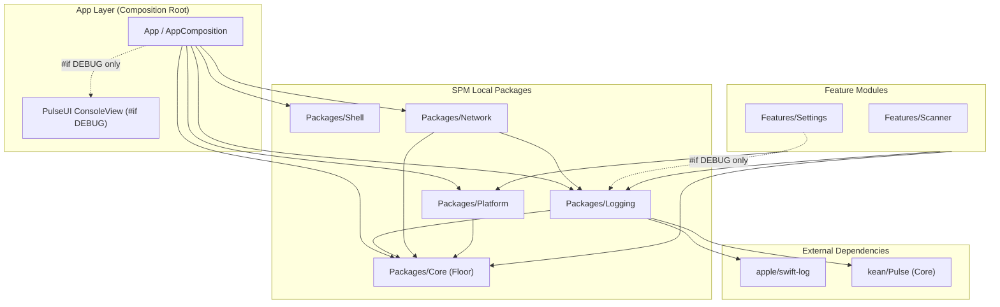
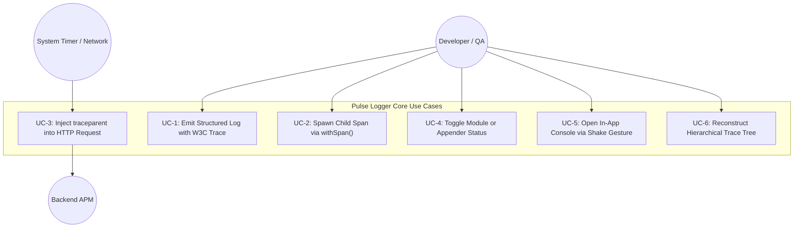
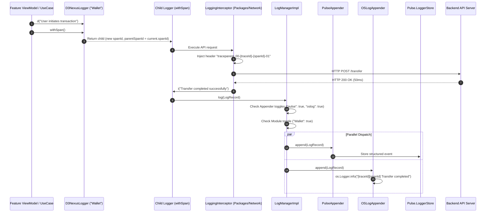

# Epic High-Level Design (HLD) — Pulse Logger for iOS

## 1. Meta Data
- **Epic Name:** `pulse_logger`
- **Status:** Planning
- **Target Release:** v1.1.0
- **Platform:** iOS Native (Swift 6, iOS 16+)
- **Source Spec:** [2026-09-19-pulse-logger-design.md](2026-09-19-pulse-logger-design.md)
- **Source Spec (Vietnamese):** [2026-09-19-pulse-logger-design.vi.md](2026-09-19-pulse-logger-design.vi.md)

---

## 2. Background
In the native iOS Super App template (`ios_digital_wallet`), logging is currently limited to a basic `Core.Logger` protocol forwarding to `os.Logger` via `ConsoleLogger.swift`. This setup lacks:
- Structured metadata and correlation tracing across asynchronous operations.
- W3C Trace Context propagation (`traceId`, `spanId`, `parentSpanId`) across layers and network boundaries.
- Flexible runtime controls (independent Module Toggles for developer noise suppression, and Appender kill-switches).
- In-app visual log and network telemetry inspection on devices/simulators.

Referencing the mature logging architecture established in the Flutter counterpart (`bloc_digital_wallet/packages/logger`), this epic establishes **`Packages/Logging`**, a governed local SPM package built upon **`apple/swift-log`** and **`kean/Pulse`** (`Pulse` core engine + `PulseUI`), fully adhering to Clean Architecture, AST governance rules (`ArchTests`), and strict compile-time release isolation.

---

## 3. Goals & Non-Goals

### Goals
1. **Dedicated Infrastructure Package (`Packages/Logging`)**:
   - Provide core logging primitives (`LogRecord`, `LogAppender`, `LogManager`, `LoggerProtocol`, `D3NexusLogger`) in an isolated local SPM package.
   - Standardize on `apple/swift-log` (`LoggingSystem.bootstrap`).
   - Preserve `Packages/Core` as the zero-dependency floor (`ArchTests` rule K7).
2. **W3C Distributed Trace Context**:
   - Automatic generation of 32-hex `traceId` and 16-hex `spanId`.
   - `withSpan()` creates child loggers linking `parentSpanId = current.spanId`.
   - Pure, side-effect-free `buildTraceTree([LogRecord]) -> [TraceNode]` function.
   - Automatic injection of `traceparent: 00-{traceId}-{spanId}-01` in `Packages/Network`'s `LoggingInterceptor`.
3. **Dual Telemetry Appender Pipeline**:
   - **`PulseAppender`**: Structured event ingestion into `Pulse.LoggerStore` for in-app inspection (`PulseUI`) and wireless streaming to **Pulse Pro (macOS)**.
   - **`OSLogAppender`**: Apple Unified Logging (`os.Logger`) for macOS Console.app, Xcode Console, and `sysdiagnose`.
4. **Independent Toggle Management**:
   - Module Toggle: Mute log output per module for debug appenders without blinding system telemetry.
   - Appender Toggle: Hard kill-switch per backend.
   - Persistence via `UserDefaults` with keys `logging.module_toggles` and `logging.appender_toggles`.
5. **In-App Developer Debug Console**:
   - Activated via **Device Shake Gesture** or an entry in **`Features/Settings`**.
   - Search, regex filtering, network timing/JSON inspection, and cURL export.
   - 100% compiled out in `#if !DEBUG` builds.
6. **Backward Compatibility**:
   - `D3NexusCoreLoggerAdapter` implements `Core.Logger`, ensuring zero breaking changes to existing call sites in `Core`, `Network`, and `Platform`.

### Non-Goals
- FLEX integration (evaluated and explicitly removed from scope).
- Headless background IPC bridge (native iOS executes `BGTaskScheduler` directly in Swift in-process).
- Third-party cloud APM SDKs (Datadog/Sentry will be added as pluggable `LogAppender`s later).

---

## 4. Architecture & Technical Design

### 4.1 High-Level Architecture

### 4.2 Use Cases

### 4.3 Primary Sequence Diagram (Logging & Network Interception)

### 4.4 Shift-Left Impact Analysis (Check 1)
- **Target Files to Create**:
  - `Packages/Logging/Package.swift`
  - `Packages/Logging/Sources/Logging/Model/LogLevel.swift`
  - `Packages/Logging/Sources/Logging/Model/LogRecord.swift`
  - `Packages/Logging/Sources/Logging/Trace/TraceNode.swift`
  - `Packages/Logging/Sources/Logging/Trace/TraceTree.swift`
  - `Packages/Logging/Sources/Logging/Appender/LogAppender.swift`
  - `Packages/Logging/Sources/Logging/Appender/PulseAppender.swift`
  - `Packages/Logging/Sources/Logging/Appender/OSLogAppender.swift`
  - `Packages/Logging/Sources/Logging/Manager/LogManager.swift`
  - `Packages/Logging/Sources/Logging/Manager/LogManagerImpl.swift`
  - `Packages/Logging/Sources/Logging/Logger/LoggerProtocol.swift`
  - `Packages/Logging/Sources/Logging/Logger/LoggerImpl.swift`
  - `Packages/Logging/Sources/Logging/Facade/D3NexusLogger.swift`
  - `Packages/Logging/Sources/Logging/Bridge/D3NexusLogHandler.swift`
  - `Packages/Logging/Sources/Logging/Adapter/D3NexusCoreLoggerAdapter.swift`
  - `Packages/Logging/Tests/LoggingTests/**`
- **Target Files to Modify**:
  - `Tuist/Package.swift` (add `apple/swift-log`, `kean/Pulse`, `Packages/Logging`)
  - `Project.swift` (add dependency `.external(name: "Logging")`)
  - `Packages/Network/Package.swift` (depend on `Logging`)
  - `Packages/Network/Sources/Network/Interceptor/LoggingInterceptor.swift` (inject W3C headers)
  - `App/Sources/Composition/AppComposition.swift` (bootstrap `D3NexusLogger`, replace `ConsoleLogger`)
  - `Features/Settings/Sources/Settings/Presentation/SettingsView.swift` (add diagnostics section under `#if DEBUG`)
- **Downstream Callers**: All classes currently injecting `Core.Logger` (retained via `D3NexusCoreLoggerAdapter`).
- **Target Test Coverage Thresholds**:
  - Core domain & dispatch logic: $\ge 90\%$ line coverage.
  - Trace tree & W3C span generation: $100\%$ line coverage.
  - AST architecture governance (`ArchTests`): $100\%$ pass.

---

## 5. Rollout Strategy & Mitigation

1. **Phased Rollout**:
   - Phase 1: Build `Packages/Logging` with isolated Unit Tests.
   - Phase 2: Wire `apple/swift-log` and `kean/Pulse`.
   - Phase 3: Connect backward-compatible `D3NexusCoreLoggerAdapter` in `App`.
   - Phase 4: Upgrade `Packages/Network` interceptor with W3C header propagation.
   - Phase 5: Integrate `PulseUI` and Developer Settings.
2. **Mitigation & Fallback**:
   - If `Pulse` storage encounters an issue, `OSLogAppender` continues unabated.
   - If an individual module generates excessive logs, developers can mute it via Settings without code change or redeployment.
   - If `Packages/Logging` needs to be rolled back, reverting `AppComposition.swift` to `ConsoleLogger` decouples the package instantly.

---

## 6. Kanban Tasks Breakdown

The epic is decomposed into 7 granular, test-driven tasks:

- [Task 1: Package Scaffolding, Data Models & Trace Tree (`task_1_scaffold_logging_package.md`)](task_1_scaffold_logging_package.md)
- [Task 2: LogManager Dispatch Engine, LoggerProtocol & Facade (`task_2_log_manager_and_facade.md`)](task_2_log_manager_and_facade.md)
- [Task 3: SwiftLog & Pulse Integration with Dual Appenders (`task_3_swift_log_and_pulse_appenders.md`)](task_3_swift_log_and_pulse_appenders.md)
- [Task 4: Core.Logger Backward-Compatibility Adapter (`task_4_core_logger_adapter.md`)](task_4_core_logger_adapter.md)
- [Task 5: Network W3C Traceparent Header Injection (`task_5_network_trace_interceptor.md`)](task_5_network_trace_interceptor.md)
- [Task 6: PulseUI In-App Console & Developer Settings Toggles (`task_6_pulse_ui_and_settings.md`)](task_6_pulse_ui_and_settings.md)
- [Task 7: Tier C System Acceptance & Architecture Governance (`task_7_acceptance_and_governance.md`)](task_7_acceptance_and_governance.md)
