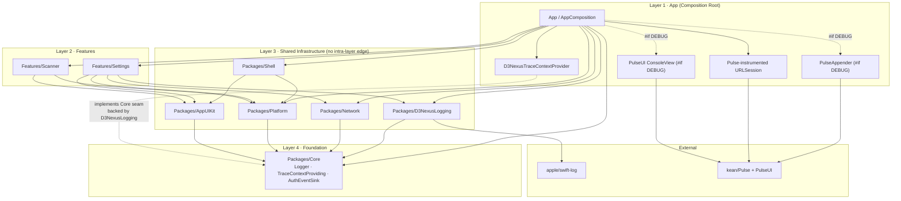
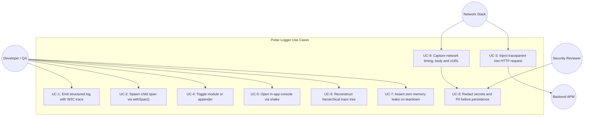
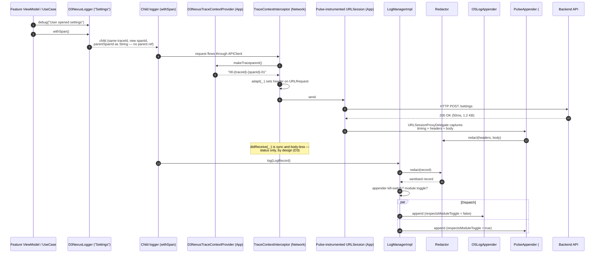
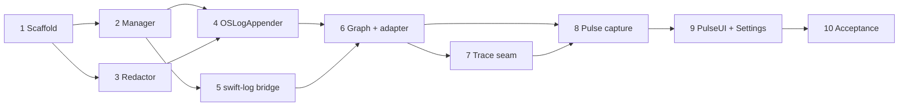

# Epic High-Level Design (HLD) — Pulse Logger for iOS

## 1. Meta Data
- **Epic Name:** `pulse_logger`
- **Status:** Planning — Gate 2 passed (task breakdown confirmed 2026-09-19)
- **Target Release:** v1.1.0
- **Platform:** iOS Native (Swift 6, iOS 16+)
- **Template Mode:** `enterprise` (see `Tuist/ProjectDescriptionHelpers/ActiveMode.swift`)
- **Source Spec:** [2026-09-19-pulse-logger-design.md](2026-09-19-pulse-logger-design.md)
- **Source Spec (Vietnamese):** [2026-09-19-pulse-logger-design.vi.md](2026-09-19-pulse-logger-design.vi.md)
- **BDD Contract:** [bdd_scenarios.md](bdd_scenarios.md)

> **This HLD supersedes the source spec's code samples.** The spec was approved at Gate 1 for
> *scope and architecture*. A Stage-2 audit against the real codebase found several of its
> illustrative Swift snippets to be built on APIs and assumptions that do not exist in this
> repository. §3 records every deviation and why. **Where the two disagree, this document wins.**

---

## 2. Background

In the native iOS Super App template (`ios_digital_wallet`), logging is limited to the three-method
`Core.Logger` protocol ([Logger.swift](../../../Packages/Core/Sources/Core/Logging/Logger.swift))
forwarding to `os.Logger` via `App/Sources/Composition/ConsoleLogger.swift`. It lacks:

- structured metadata and correlation across asynchronous operations;
- W3C Trace Context propagation (`traceId` / `spanId` / `parentSpanId`) across layers and the
  network boundary;
- runtime controls (per-module mute for developer noise, per-appender kill-switch);
- in-app visual log and network telemetry inspection on device or simulator;
- any PII redaction seam — relevant because this template is the base for a fintech wallet.

Referencing the logging architecture already validated in the Flutter counterpart
(`bloc_digital_wallet/packages/logger`), this epic establishes **`Packages/D3NexusLogging`**: a
governed local SPM package built on **`apple/swift-log`**, with **`kean/Pulse`** wired at the
composition root, adhering to Clean Architecture, the AST governance rules in `ArchTests`, strict
compile-time release isolation, and explicit memory-leak prevention.

---

## 3. Deviations from the Source Spec (Gate 2 decisions)

Every row is a correction of *implementation detail*, not of approved scope. Each was confirmed by
the engineering lead at the Gate 2 checkpoint.

| # | Source spec said | Reality in this repo | Decision |
|---|---|---|---|
| **D1** | Package named `Packages/Logging`, module `Logging` | `apple/swift-log` ships its library product **and module** as `Logging`. A local target of the same name that depends on it is a SwiftPM duplicate-module error, and every consumer's `import Logging` becomes ambiguous. | Package and module renamed **`D3NexusLogging`**, matching the `D3NexusLogger` / `D3NexusLogHandler` names the spec already used. swift-log is **kept**. |
| **D2** | `LoggerProtocol` exposes `d` / `i` / `w` / `e` / `v` | `quality/.swiftlint.yml` `identifier_name.excluded` is `[id, to, x, y, t]`; CI runs `swiftlint --strict`. The repo already hit this once — see the doc comment in `Packages/Core/Sources/Core/Logging/Logger.swift`. | Methods are **`debug` / `info` / `warning` / `error` / `verbose`**, which also makes `D3NexusCoreLoggerAdapter` a 1:1 mapping onto `Core.Logger`. |
| **D3** | `protocol Interceptor { intercept(request:) ; intercept(response:data:) }` | The real protocol is `RequestInterceptor` with `adapt(_:) async -> URLRequest`, `didReceive(_ response: HTTPURLResponse)` and `retry(_:dueTo:)`. **`didReceive` is synchronous, receives no `Data` and no timing.** | Header injection moves to a new `TraceContextInterceptor` written against the real signature (Task 7). Response duration / byte size / body capture move to the `URLSession` layer (D5, Task 8) — the interceptor chain structurally cannot provide them. |
| **D4** | `Packages/Network` depends on `Packages/Logging` | `docs/architecture/ARCHITECTURE.md` §3 declares Layer 3 to be "sibling modules, **no intra-layer edge**" and the whole graph "a one-way DAG"; `Packages/Network/Package.swift` documents "Depends on `Core` **only**". | A minimal **`Core.TraceContextProviding`** seam, mirroring the existing `Core.AuthEventSink` precedent (Source Spec Changelog #8). `Network` stays a `Core`-only leaf and **no governance rule is amended**. |
| **D5** | `PulseAppender` lives inside the logging package | Every existing local package has path dependencies only. CI runs `for dir in Packages/* Features/*; do swift test --package-path "$dir"` on the **macOS host**, so a remote Pulse dependency would have to resolve for the package and every downstream consumer, on every standalone build. | **Pulse lives in `App/` only**, where it is already an external via Tuist. `Packages/D3NexusLogging` keeps exactly one remote dependency (swift-log, a pure-Swift leaf). This also honours Non-Goal 3 — appenders stay pluggable. |
| **D6** | `spanId` from `String(UUID().uuidString.prefix(16))` | `uuidString` is `XXXXXXXX-XXXX-…`; the first 16 characters contain `-` at index 8 and 13, so the value fails the spec's own `^[0-9a-f]{16}$` regex. | IDs are generated from random bytes: `String(format: "%016llx", UInt64.random(in: .min ... .max))` and the 128-bit equivalent for `traceId`. |
| **D7** | `buildTraceTree` returns a forest of `final class TraceNode` with `var children`, marked `@unchecked Sendable` | Two records whose `spanId`/`parentSpanId` reference each other produce a cycle: traversal never terminates and the class graph leaks — contradicting Goal 6 of this very epic. | `TraceNode` becomes a **value type** built bottom-up, with explicit cycle detection and a depth cap. The leak class is removed by construction rather than asserted away. |
| **D8** | `D3NexusLogger.getLogger` calls `fatalError` when uninitialised, via a default argument | A default argument is evaluated at every call site; a change in composition order crashes the app in production. | Falls back to a **`NoOpLogger`**, with `assertionFailure` in DEBUG so misuse is still loud during development. |

### 3.1 Items the source spec asserted but assigned to no task

These were found unowned during the Stage-2 audit and now have explicit owners.

| Gap | Where the spec claimed it | New owner |
|---|---|---|
| PII redaction (`Authorization` / `Cookie` / `X-API-Key` masking, PAN / CVV / PIN / OTP patterns) | §6 Security & PII Redaction | **Task 3** |
| Line-coverage thresholds (≥85% domain, 100% security) | §7 Testing Strategy, and Gate 4 | **Task 10** — CI currently runs `swift test` with no `--enable-code-coverage` and has no threshold script, so the numbers were unmeasurable. |
| Release isolation proof ("no PulseUI references in the production binary") | BDD 6.2 | **Task 9** |
| `ArchTests` K7 sibling list | — | **Task 6** — `HostRulesTests.coreSiblings` is hard-coded; without the new name, `Core` could import the logging package undetected. |
| `lean` template mode wiring | — | **Task 6** — `Tuist/Package.swift` and `Project.swift` each carry a *second*, hand-maintained dependency list for `lean`. |
| Mason brick `ios_mvi_feature` | — | **Task 6** — the brick injects `Core.Logger`, so every future generated feature inherits the old seam. |

---

## 4. Goals & Non-Goals

### Goals
1. **Dedicated infrastructure package (`Packages/D3NexusLogging`)** — `LogRecord`, `LogAppender`,
   `LogManager`, `LoggerProtocol`, `D3NexusLogger`; standardised on `apple/swift-log`
   (`LoggingSystem.bootstrap`); `Packages/Core` preserved as the zero-dependency floor (K7).
2. **W3C distributed trace context & hierarchy** — 32-hex `traceId`, 16-hex `spanId`; `withSpan()`
   links `parentSpanId` with zero retain cycles; a pure, cycle-safe
   `buildTraceTree([LogRecord]) -> [TraceNode]`; `traceparent: 00-{traceId}-{spanId}-01` injected
   on outbound requests.
3. **Dual telemetry appender pipeline** — `OSLogAppender` (Apple Unified Logging: Console.app,
   Xcode, `sysdiagnose`) inside the package; `PulseAppender` plus Pulse's `URLSession` capture at
   the composition root, for in-app inspection and wireless streaming to Pulse Pro.
4. **Independent toggle management** — per-module mute honoured by debug appenders only, per-appender
   kill-switch, persisted in `UserDefaults` under `logging.module_toggles` / `logging.appender_toggles`.
5. **In-app developer console** — shake gesture or a `Features/Settings` entry; search, regex filter,
   network timing / JSON inspection, cURL export; 100% compiled out under `#if !DEBUG`.
6. **PII redaction as a first-class component** — applied at the `LogManagerImpl` boundary so every
   appender inherits it, and at the Pulse `URLSession` capture path, which records full bodies.
7. **Memory leak & retain cycle guard** — `trackForMemoryLeaks` teardown helper; child loggers hold
   only value-type trace IDs; `leaks` / MallocStackLogging verification in Tier C.
8. **Backward compatibility** — `D3NexusCoreLoggerAdapter` implements `Core.Logger`, so the 22
   existing call sites (§5.4) keep working unmodified.

### Non-Goals
- FLEX or MLeaksFinder (rejected: MLeaksFinder swizzles UIKit `UIViewController`, incompatible with
  this pure-SwiftUI `NavigationStack` architecture; FLEX carries heavy Obj-C runtime baggage).
- Headless background IPC bridge (native iOS runs `BGTaskScheduler` in-process).
- Third-party cloud APM SDKs — Datadog / Sentry arrive later as pluggable `LogAppender`s, which D5
  keeps cheap.
- Changing the `plugin` template mode: `PluginDevbed.xcworkspace` is out of scope and untouched.

---

## 5. Architecture & Technical Design

### 5.1 High-Level Architecture



**Invariant preserved:** every solid arrow still flows to a strictly lower tier. `Network` gains no
Layer-3 sibling edge — it reaches trace context through `Core.TraceContextProviding`, bound at the
composition root, exactly as it reaches logout through `Core.AuthEventSink`.

### 5.2 Use Cases



### 5.3 Primary Sequence — logging, trace injection and network capture



### 5.4 Check 1 — Shift-Left Impact Analysis

Run on 2026-09-19 against `develop`:

```bash
python3 skills/impact-analysis/resources/scripts/check_code_impact.py \
  --files Packages/Network/Sources/Network/Interceptor/LoggingInterceptor.swift \
          App/Sources/Composition/AppComposition.swift \
          App/Sources/Composition/ConsoleLogger.swift \
          App/Sources/Composition/NetworkComposition.swift \
          Packages/Network/Package.swift Tuist/Package.swift Project.swift \
          Features/Settings/Sources/Settings/Presentation/SettingsView.swift \
  --symbols Logger ConsoleLogger LoggingInterceptor RequestInterceptor \
  --base-ref develop
```

- **Upstream git conflict:** 🟢 clean, zero unmerged commits against `develop`.
- **Blast radius:** **22 downstream caller files** across `Core`, `Network`, `Platform`, `Settings`,
  `App` — and, critically, `bricks/ios_mvi_feature/__brick__/`, the Mason template. `Core.Logger` is
  threaded through `CacheStore`, `SecureCacheStore`, `SafeExecution`, `DeepLinkRouter`, `APIClient`
  and every generated repository. This is precisely why `D3NexusCoreLoggerAdapter` (Goal 8) is not
  optional: without it the epic touches all 22.
- **Cross-platform bridges:** none — no `MethodChannel` in this repo.
- **Coverage safety net:** the script reports 0% on the listed files because its pairing heuristic
  looks for `<Name>Tests.swift` adjacency. `Packages/Network/Tests/NetworkTests/LoggingInterceptorTests.swift`
  **does** exist; the composition-root files genuinely have no paired unit test. Task 10 installs
  real measurement rather than relying on this heuristic.

### 5.5 New and modified files

**Created**
```
Packages/D3NexusLogging/Package.swift
Packages/D3NexusLogging/Sources/D3NexusLogging/Model/{LogLevel,LogRecord}.swift
Packages/D3NexusLogging/Sources/D3NexusLogging/Trace/{TraceIdentifier,TraceNode,TraceTree}.swift
Packages/D3NexusLogging/Sources/D3NexusLogging/Redaction/{Redactor,RedactionRule}.swift
Packages/D3NexusLogging/Sources/D3NexusLogging/Appender/{LogAppender,OSLogAppender}.swift
Packages/D3NexusLogging/Sources/D3NexusLogging/Manager/{LogManager,LogManagerImpl,ToggleStore}.swift
Packages/D3NexusLogging/Sources/D3NexusLogging/Logger/{LoggerProtocol,LoggerImpl,NoOpLogger}.swift
Packages/D3NexusLogging/Sources/D3NexusLogging/Facade/D3NexusLogger.swift
Packages/D3NexusLogging/Sources/D3NexusLogging/Bridge/D3NexusLogHandler.swift
Packages/D3NexusLogging/Tests/D3NexusLoggingTests/**
Packages/Core/Sources/Core/Logging/TraceContextProviding.swift
Packages/Network/Sources/Network/Interceptor/TraceContextInterceptor.swift
App/Sources/Composition/LoggingComposition.swift
App/Sources/Composition/D3NexusTraceContextProvider.swift
App/Sources/Composition/PulseAppender.swift              (#if DEBUG)
App/Sources/UI/ShakeGestureModifier.swift                (#if DEBUG)
Features/Settings/Sources/Settings/Presentation/Diagnostics/**   (#if DEBUG)
scripts/check_coverage_thresholds.sh
```

**Modified**
```
Tuist/Package.swift          — marker region (enterprise) AND the hand-written lean array
Project.swift                — enterprise AND lean target dependency lists
Workspace.swift              — verify package inclusion
ArchTests/Tests/ArchTests/HostRulesTests.swift  — add "D3NexusLogging" to coreSiblings
App/Sources/Composition/AppComposition.swift    — ConsoleLogger -> D3NexusCoreLoggerAdapter
App/Sources/Composition/NetworkComposition.swift — accept the instrumented URLSession
Features/Settings/Sources/Settings/Presentation/SettingsView.swift  (#if DEBUG section)
bricks/ios_mvi_feature/__brick__/**             — generated features use the new seam
docs/architecture/ARCHITECTURE.md               — module map + Layer 3 graph
.github/workflows/ci.yml                        — coverage instrumentation
```

**Deleted**: `App/Sources/Composition/ConsoleLogger.swift` (replaced; kept until Task 6 proves the
adapter, so rollback is one file).

### 5.6 Coverage thresholds (Gate 4)

| Area | Threshold |
|---|---|
| `Redaction/**` (security-sensitive) | **100%** line |
| `Trace/**` — ID generation, tree building | **100%** line |
| `Manager/**`, `Logger/**` — dispatch, toggles, spans | ≥ 90% line |
| `Appender/**`, `Bridge/**` | ≥ 85% line |
| Diagnostics view model (UI state) | ≥ 80% line |
| `ArchTests` K1–K10 | 100% pass |

---

## 6. Rollout Strategy & Mitigation

1. **Phase 1 (Tasks 1–5)** — build `Packages/D3NexusLogging` standalone: models, dispatch, redaction,
   `OSLogAppender`, swift-log bridge. Nothing in the app changes; `swift test --package-path
   Packages/D3NexusLogging` is the only gate.
2. **Phase 2 (Task 6)** — wire the package into all three template modes and swap the composition
   root behind `D3NexusCoreLoggerAdapter`. First point at which app behaviour changes.
3. **Phase 3 (Task 7)** — `Core` trace seam and the `Network` interceptor.
4. **Phase 4 (Task 8)** — Pulse at the composition root: appender + instrumented `URLSession`.
5. **Phase 5 (Tasks 9–10)** — PulseUI console, Settings diagnostics, acceptance and governance.

**Mitigation & fallback**
- If Pulse storage misbehaves, `OSLogAppender` is unaffected — it is in a different package with no
  Pulse dependency at all.
- A noisy module is muted at runtime from Settings; no redeploy.
- Rolling back the whole epic is reverting `AppComposition.swift` to `ConsoleLogger`: the package
  becomes dead code rather than a breaking change, because every call site still speaks `Core.Logger`.
- Rolling back only Pulse is deleting the App-layer appender and session instrumentation — D5 is what
  makes this a two-file revert instead of a package-graph change.

---

## 7. Kanban Tasks Breakdown

| # | Task | Blocked by |
|---|---|---|
| 1 | [Package scaffolding, data models & cycle-safe trace tree](task_1_scaffold_logging_package.md) | — |
| 2 | [LogManager dispatch engine, LoggerProtocol & facade](task_2_log_manager_and_facade.md) | 1 |
| 3 | [Redactor — secret masking & PII patterns](task_3_redactor_pii_masking.md) | 1 |
| 4 | [OSLogAppender & toggle persistence](task_4_oslog_appender.md) | 2, 3 |
| 5 | [swift-log bridge — D3NexusLogHandler](task_5_swift_log_bridge.md) | 2 |
| 6 | [Graph wiring across template modes, Core.Logger adapter & Mason brick](task_6_graph_wiring_and_core_adapter.md) | 4, 5 |
| 7 | [Core.TraceContextProviding seam & Network TraceContextInterceptor](task_7_trace_context_seam_and_interceptor.md) | 6 |
| 8 | [Pulse appender & instrumented URLSession capture](task_8_pulse_appender_and_session_capture.md) | 6, 7 |
| 9 | [PulseUI console, shake gesture & Settings diagnostics](task_9_pulse_ui_and_settings.md) | 8 |
| 10 | [Tier C acceptance, governance & coverage tooling](task_10_acceptance_and_governance.md) | 9 |


