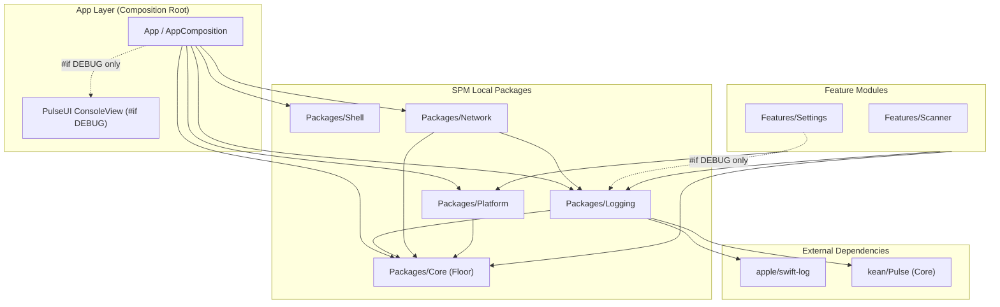
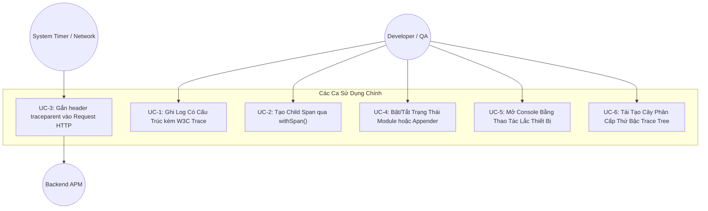
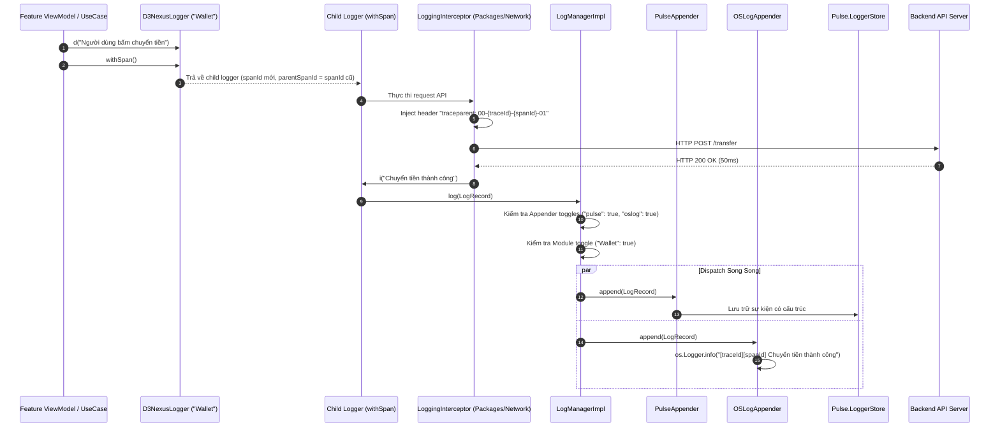

# Tài liệu Thiết kế Tổng thể (HLD) — Pulse Logger cho iOS

## 1. Thông tin Chung (Meta Data)
- **Tên Epic:** `pulse_logger`
- **Trạng thái:** Đang lập kế hoạch (Planning)
- **Phiên bản Mục tiêu:** v1.1.0
- **Nền tảng:** iOS Native (Swift 6, iOS 16+)
- **Tài liệu Đặc tả Gốc (Tiếng Anh):** [2026-09-19-pulse-logger-design.md](2026-09-19-pulse-logger-design.md)
- **Tài liệu Đặc tả Gốc (Tiếng Việt):** [2026-09-19-pulse-logger-design.vi.md](2026-09-19-pulse-logger-design.vi.md)

---

## 2. Bối cảnh (Background)
Trong template ứng dụng iOS Super App (`ios_digital_wallet`), hệ thống ghi log hiện tại mới dừng lại ở mức giao diện `Core.Logger` tối giản và ủy quyền sang `os.Logger` qua `ConsoleLogger.swift`. Giải pháp này bộc lộ nhiều hạn chế:
- Thiếu siêu dữ liệu có cấu trúc (structured metadata) và khả năng truy vết tương quan giữa các tác vụ bất đồng bộ.
- Chưa hỗ trợ W3C Trace Context (`traceId`, `spanId`, `parentSpanId`) xuyên suốt các tầng kiến trúc và ranh giới mạng.
- Thiếu cơ chế kiểm soát linh hoạt khi chạy (Module Toggles để lọc bớt nhiễu theo tính năng, và Appender kill-switches).
- Thiếu công cụ xem log và kiểm tra lưu lượng mạng trực tiếp trên thiết bị thực hoặc giả lập.

Tham chiếu từ hệ thống logging đã hoàn thiện bên Flutter (`bloc_digital_wallet/packages/logger`), epic này xây dựng **`Packages/Logging`**, một local SPM package chuẩn mực được xây dựng trên nền tảng **`apple/swift-log`** và **`kean/Pulse`** (`Pulse` core engine + `PulseUI`), tuân thủ chặt chẽ Clean Architecture, các quy tắc kiểm thử AST (`ArchTests`), và cơ chế cách ly tuyệt đối trên bản phát hành (Release).

---

## 3. Mục tiêu (Goals) & Phạm vi Không Thực Hiện (Non-Goals)

### Mục tiêu Cốt lõi
1. **Package Hạ Tầng Chuyên Biệt (`Packages/Logging`)**:
   - Cung cấp các abstractions cốt lõi (`LogRecord`, `LogAppender`, `LogManager`, `LoggerProtocol`, `D3NexusLogger`) trong package SPM cục bộ riêng biệt.
   - Chuẩn hóa trên thư viện `apple/swift-log` (`LoggingSystem.bootstrap`).
   - Duy trì `Packages/Core` làm dependency floor thuần túy (không dependency bên ngoài, tuân thủ quy tắc `ArchTests K7`).
2. **Ngữ cảnh Phân tán Chuẩn W3C (Distributed Trace Context)**:
   - Tự động sinh `traceId` (32 ký tự hex) và `spanId` (16 ký tự hex).
   - Hàm `withSpan()` sinh child logger liên kết `parentSpanId = current.spanId`.
   - Hàm thuần túy `buildTraceTree([LogRecord]) -> [TraceNode]` dựng cây thứ bậc.
   - Tự động gắn header `traceparent: 00-{traceId}-{spanId}-01` trong `LoggingInterceptor` của `Packages/Network`.
3. **Đường Ống Ghi Log Kép (Dual Telemetry Appender Pipeline)**:
   - **`PulseAppender`**: Thu thập log có cấu trúc vào `Pulse.LoggerStore` phục vụ xem trực tiếp trên app (`PulseUI`) và truyền không dây sang **Pulse Pro (macOS)**.
   - **`OSLogAppender`**: Apple Unified Logging (`os.Logger`) tối ưu cho Console.app, Xcode Console và thu thập `sysdiagnose`.
4. **Kiểm Soát Tắt/Bật Độc Lập**:
   - Module Toggle: Mute log cho từng module đối với appender debug mà không làm mất log telemetry hệ thống.
   - Appender Toggle: Kill-switch ngắt hoàn toàn từng backend.
   - Lưu trữ bền vững qua `UserDefaults` (`logging.module_toggles`, `logging.appender_toggles`).
5. **Giao Diện Debug Console Trong Ứng Dụng**:
   - Mở nhanh bằng **Thao Tác Lắc Máy (Shake Gesture)** hoặc qua mục trong **`Features/Settings`**.
   - Tìm kiếm, lọc regex, kiểm tra thông số mạng, JSON viewer và xuất lệnh `cURL`.
   - Loại bỏ 100% bằng cờ biên dịch `#if !DEBUG` trên bản Release.
6. **Tương Thích Ngược Hoàn Toàn**:
   - `D3NexusCoreLoggerAdapter` kế thừa `Core.Logger`, đảm bảo không gây break code tại các call site hiện có trong `Core`, `Network`, và `Platform`.

### Phạm vi Không Thực Hiện (Non-Goals)
- Tích hợp FLEX (đã đánh giá và thống nhất loại bỏ khỏi epic).
- Cầu nối IPC cho background headless (trên iOS native, `BGTaskScheduler` chạy Swift in-process; App Extensions dùng App Group).
- Tích hợp APM cloud bên thứ ba (Datadog/Sentry sẽ được gắn dưới dạng các `LogAppender` độc lập sau này).

---

## 4. Kiến Trúc & Thiết Kế Kỹ Thuật

### 4.1 Sơ Đồ Kiến Trúc Tổng Thể

### 4.2 Biểu Đồ Ca Sử Dụng (Use Cases)

### 4.3 Sơ Đồ Tuần Tự Chính (Sequence Diagram)

### 4.4 Phân Tích Tác Động Shift-Left (Check 1)
- **Tập Tin Sẽ Tạo Mới**:
  - `Packages/Logging/Package.swift`
  - `Packages/Logging/Sources/Logging/Model/LogLevel.swift`
  - `Packages/Logging/Sources/Logging/Model/LogRecord.swift`
  - `Packages/Logging/Sources/Logging/Trace/TraceNode.swift`
  - `Packages/Logging/Sources/Logging/Trace/TraceTree.swift`
  - `Packages/Logging/Sources/Logging/Appender/LogAppender.swift`
  - `Packages/Logging/Sources/Logging/Appender/PulseAppender.swift`
  - `Packages/Logging/Sources/Logging/Appender/OSLogAppender.swift`
  - `Packages/Logging/Sources/Logging/Manager/LogManager.swift`
  - `Packages/Logging/Sources/Logging/Manager/LogManagerImpl.swift`
  - `Packages/Logging/Sources/Logging/Logger/LoggerProtocol.swift`
  - `Packages/Logging/Sources/Logging/Logger/LoggerImpl.swift`
  - `Packages/Logging/Sources/Logging/Facade/D3NexusLogger.swift`
  - `Packages/Logging/Sources/Logging/Bridge/D3NexusLogHandler.swift`
  - `Packages/Logging/Sources/Logging/Adapter/D3NexusCoreLoggerAdapter.swift`
  - `Packages/Logging/Tests/LoggingTests/**`
- **Tập Tin Cần Sửa Đổi**:
  - `Tuist/Package.swift` (bổ sung `apple/swift-log`, `kean/Pulse`, `Packages/Logging`)
  - `Project.swift` (khai báo dependency `.external(name: "Logging")`)
  - `Packages/Network/Package.swift` (phụ thuộc vào `Logging`)
  - `Packages/Network/Sources/Network/Interceptor/LoggingInterceptor.swift` (gắn W3C headers)
  - `App/Sources/Composition/AppComposition.swift` (khởi tạo `D3NexusLogger`, thay thế `ConsoleLogger`)
  - `Features/Settings/Sources/Settings/Presentation/SettingsView.swift` (thêm section chẩn đoán dưới `#if DEBUG`)
- **Tác Động Tới Các Module Khác**: Toàn bộ các lớp hiện dùng `Core.Logger` tiếp tục hoạt động thông qua `D3NexusCoreLoggerAdapter`.
- **Ngưỡng Bao Phủ Kiểm Thử (Coverage Thresholds)**:
  - Logic cốt lõi & điều phối (Dispatch Engine): $\ge 90\%$ line coverage.
  - Trace Tree & W3C Span Generation: $100\%$ line coverage.
  - Kiểm thử kiến trúc AST (`ArchTests`): Đạt 100%.

---

## 5. Kế Hoạch Triển Khai & Kiểm Soát Rủi Ro

1. **Triển Khai Theo Giai Đoạn (Phased Rollout)**:
   - Giai đoạn 1: Khởi tạo `Packages/Logging` với đầy đủ Unit Tests cô lập.
   - Giai đoạn 2: Tích hợp `apple/swift-log` và `kean/Pulse`.
   - Giai đoạn 3: Kết nối `D3NexusCoreLoggerAdapter` tương thích ngược tại `App`.
   - Giai đoạn 4: Nâng cấp interceptor trong `Packages/Network` hỗ trợ W3C traceparent.
   - Giai đoạn 5: Tích hợp `PulseUI` và giao diện cấu hình trong Settings.
2. **Kế Hoạch Dự Phòng (Fallback Plan)**:
   - Nếu storage của `Pulse` gặp sự cố, `OSLogAppender` vẫn tiếp tục hoạt động độc lập không bị ảnh hưởng.
   - Nếu một module gây spam log, dev có thể tắt module đó tức thì trong Settings mà không cần build lại app.
   - Nếu cần rollback toàn bộ, chỉ cần revert `AppComposition.swift` về `ConsoleLogger`.

---

## 6. Danh Mục Công Việc Kanban (Tasks Breakdown)

Toàn bộ epic được chia thành 7 task cụ thể tuân thủ BDD & TDD:

- [Task 1: Khởi Tạo Package, Mô Hình Dữ Liệu & Trace Tree (`task_1_scaffold_logging_package.md`)](task_1_scaffold_logging_package.md)
- [Task 2: Động Cơ Điều Phối LogManager, LoggerProtocol & Facade (`task_2_log_manager_and_facade.md`)](task_2_log_manager_and_facade.md)
- [Task 3: Tích Hợp SwiftLog, Pulse & Dual Appenders (`task_3_swift_log_and_pulse_appenders.md`)](task_3_swift_log_and_pulse_appenders.md)
- [Task 4: Adapter Tương Thích Ngược Core.Logger (`task_4_core_logger_adapter.md`)](task_4_core_logger_adapter.md)
- [Task 5: Gắn Header W3C Traceparent trong Network Interceptor (`task_5_network_trace_interceptor.md`)](task_5_network_trace_interceptor.md)
- [Task 6: Màn Hình Debug PulseUI & Quản Lý Toggles trong Settings (`task_6_pulse_ui_and_settings.md`)](task_6_pulse_ui_and_settings.md)
- [Task 7: Kiểm Thử Nghiệm Thu Hệ Thống Tier C & Governance (`task_7_acceptance_and_governance.md`)](task_7_acceptance_and_governance.md)
