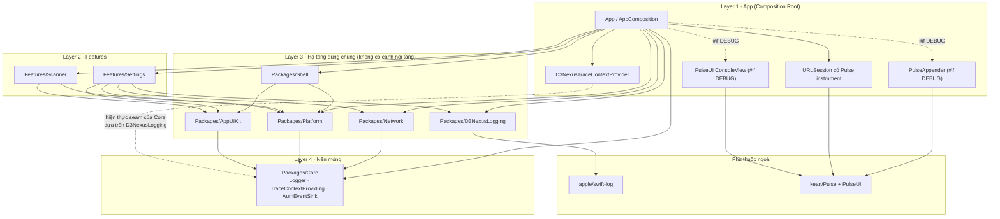
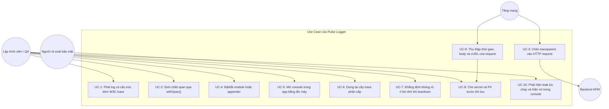
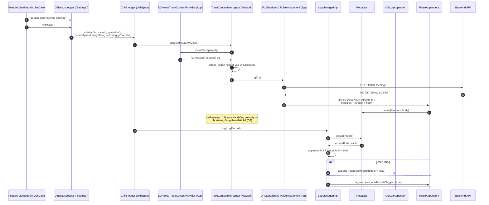
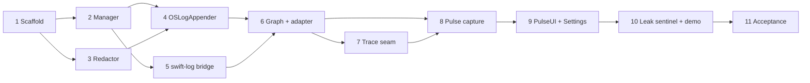

# Thiết kế Tổng thể Epic (HLD) — Pulse Logger cho iOS

## 1. Thông tin chung
- **Tên Epic:** `pulse_logger`
- **Trạng thái:** Done
- **Bản phát hành đích:** v1.1.0
- **Nền tảng:** iOS Native (Swift 6, iOS 16+)
- **Template Mode:** `enterprise` (xem `Tuist/ProjectDescriptionHelpers/ActiveMode.swift`)
- **Spec gốc:** [2026-09-19-pulse-logger-design.md](2026-09-19-pulse-logger-design.md)
- **Spec gốc (Tiếng Việt):** [2026-09-19-pulse-logger-design.vi.md](2026-09-19-pulse-logger-design.vi.md)
- **Hợp đồng BDD:** [bdd_scenarios.md](bdd_scenarios.md)

> **Tài liệu này thay thế các đoạn code mẫu trong spec gốc.** Spec được duyệt ở Gate 1 cho *phạm vi
> và kiến trúc*. Bước rà soát Stage 2 đối chiếu với codebase thật cho thấy một số snippet Swift minh
> hoạ trong spec dựa trên API và giả định **không tồn tại** trong repo này. §3 ghi lại từng sai lệch
> kèm lý do. **Khi hai tài liệu mâu thuẫn, tài liệu này là chuẩn.**

---

## 2. Bối cảnh

Trong template iOS Super App (`ios_digital_wallet`), logging hiện chỉ gói gọn trong protocol ba
phương thức `Core.Logger` ([Logger.swift](../../../Packages/Core/Sources/Core/Logging/Logger.swift))
chuyển tiếp sang `os.Logger` qua `App/Sources/Composition/ConsoleLogger.swift`. Nó thiếu:

- metadata có cấu trúc và khả năng tương quan (correlation) xuyên các thao tác bất đồng bộ;
- lan truyền W3C Trace Context (`traceId` / `spanId` / `parentSpanId`) qua các tầng và qua biên mạng;
- cơ chế điều khiển lúc chạy (tắt tiếng theo module cho lập trình viên, kill-switch theo appender);
- công cụ xem log và telemetry mạng ngay trong app trên máy thật hoặc simulator;
- bất kỳ seam nào để che dữ liệu nhạy cảm — điều đáng lưu ý vì template này là nền cho một ví fintech.

Tham chiếu kiến trúc logging đã được kiểm chứng ở phía Flutter (`bloc_digital_wallet/packages/logger`),
epic này thiết lập **`Packages/D3NexusLogging`**: một local SPM package được quản trị chặt, xây trên
**`apple/swift-log`**, với **`kean/Pulse`** được đấu nối tại composition root, tuân thủ Clean
Architecture, các luật quản trị AST trong `ArchTests`, cách ly Release ở mức biên dịch, và phòng
ngừa rò rỉ bộ nhớ một cách tường minh.

---

## 3. Sai lệch so với Spec gốc (các quyết định Gate 2)

Mỗi dòng là một hiệu chỉnh về *chi tiết hiện thực*, không phải về phạm vi đã duyệt. Tất cả đã được
Engineering Lead xác nhận tại checkpoint Gate 2.

| # | Spec gốc nói | Thực tế trong repo | Quyết định |
|---|---|---|---|
| **D1** | Package tên `Packages/Logging`, module `Logging` | `apple/swift-log` ship library product **và module** đều tên `Logging`. Một local target trùng tên mà lại depend vào nó là lỗi duplicate-module của SwiftPM, và mọi `import Logging` ở phía consumer trở thành nhập nhằng. | Package và module đặt tên **`D3NexusLogging`**, giữ nguyên bộ tên `D3Nexus*` mà spec vốn đã dùng. Package này được chủ đích **tách ra thành SDK phân phối** (§3.2), nên một cái tên mang dấu ấn vendor là đúng chứ không phải ngẫu nhiên. **Giữ** swift-log. Xem D1.1. |
| **D2** | `LoggerProtocol` phơi ra `d` / `i` / `w` / `e` / `v` | `quality/.swiftlint.yml` có `identifier_name.excluded` là `[id, to, x, y, t]`; CI chạy `swiftlint --strict`. Repo đã vướng đúng luật này một lần — xem doc comment trong `Packages/Core/Sources/Core/Logging/Logger.swift`. | Đặt tên **`debug` / `info` / `warning` / `error` / `verbose`**, đồng thời giúp `D3NexusCoreLoggerAdapter` ánh xạ 1:1 sang `Core.Logger`. |
| **D3** | `protocol Interceptor { intercept(request:) ; intercept(response:data:) }` | Protocol thật là `RequestInterceptor` với `adapt(_:) async -> URLRequest`, `didReceive(_ response: HTTPURLResponse)` và `retry(_:dueTo:)`. **`didReceive` là đồng bộ, không nhận `Data`, không có thông tin thời gian.** | Việc chèn header chuyển sang `TraceContextInterceptor` mới, viết theo đúng chữ ký thật (Task 7). Thời lượng / kích thước / body phản hồi chuyển xuống tầng `URLSession` (D5, Task 8) — chuỗi interceptor về mặt cấu trúc không thể cung cấp những dữ liệu đó. |
| **D4** | `Packages/Network` phụ thuộc `Packages/Logging` | `docs/architecture/ARCHITECTURE.md` §3 tuyên bố Layer 3 là "sibling modules, **no intra-layer edge**" và toàn đồ thị là "a one-way DAG"; `Packages/Network/Package.swift` ghi "Depends on `Core` **only**". | Dùng seam tối giản **`Core.TraceContextProviding`**, đúng theo tiền lệ `Core.AuthEventSink` đã có (Source Spec Changelog #8). `Network` vẫn là leaf chỉ phụ thuộc `Core` và **không phải sửa luật quản trị nào**. |
| **D5** | `PulseAppender` nằm bên trong package logging | Một remote dependency trong local package tự nó không bất thường — `Packages/Platform` đã depend vào `Factory`. Phản đối ở đây là dành riêng cho Pulse: nó là dependency nặng (lưu trữ, capture mạng, và cả một console SwiftUI), CI chạy `for dir in Packages/* Features/*; do swift test --package-path "$dir"` trên **macOS host**, và **một SDK đã tách (§3.2) không được ép Pulse lên mọi consumer chỉ muốn structured logging**. | **Pulse chỉ nằm trong `App/`**, nơi nó vốn đã là external qua Tuist. `Packages/D3NexusLogging` giữ đúng một remote dependency (swift-log, một leaf thuần Swift). Điều này tôn trọng Non-Goal 3 — appender vẫn cắm-rút được — và là điều kiện tiên quyết để tách. |
| **D6** | `spanId` lấy từ `String(UUID().uuidString.prefix(16))` | `uuidString` có dạng `XXXXXXXX-XXXX-…`; 16 ký tự đầu chứa dấu `-` ở vị trí 8 và 13, nên giá trị này fail chính regex `^[0-9a-f]{16}$` của spec. | Sinh ID từ byte ngẫu nhiên: `String(format: "%016llx", UInt64.random(in: .min ... .max))` và tương đương 128-bit cho `traceId`. |
| **D7** | `buildTraceTree` trả về rừng `final class TraceNode` với `var children`, gắn `@unchecked Sendable` | Hai record có `spanId`/`parentSpanId` trỏ lẫn nhau tạo thành cycle: duyệt cây không bao giờ dừng và đồ thị class bị leak — mâu thuẫn với chính Goal 6 của epic này. | `TraceNode` trở thành **value type**, dựng từ dưới lên, có phát hiện cycle và giới hạn độ sâu. Lớp rủi ro leak bị loại bỏ bằng thiết kế thay vì bằng assertion. |
| **D8** | `D3NexusLogger.getLogger` gọi `fatalError` khi chưa khởi tạo, qua default argument | Default argument được đánh giá tại **mọi** call site; một thay đổi thứ tự composition sẽ làm crash app ở production. | Fallback về **`NoOpLogger`**, kèm `assertionFailure` trong DEBUG để lỗi dùng sai vẫn ồn ào lúc phát triển. |

#### D1.1 — quyết định đặt tên, và vì sao loại `Logger` / `logger` / `AppLogging`

Ba phương án đã được cân nhắc và loại trước khi chốt `D3NexusLogging`.

**`Logging`** — không dùng được. `apple/swift-log` đã chiếm tên module đó (D1).

**`Logger` / `logger`** — không dùng được vì một lý do khác hẳn. `Packages/Core/Sources/Core/Logging/Logger.swift`
khai báo `public protocol Logger`, được tham chiếu *không qualify* ở 19 chỗ: `Core/Cache/CacheStore.swift`,
`Core/Cache/SecureCacheStore.swift`, `Core/SafeExecution.swift`, `Network/APIClient.swift`,
`Settings/SettingsContainer.swift`, `Settings/Data/Repository/SettingsRepositoryImpl.swift`, vài file
`TestSupport.swift`, và **`bricks/ios_mvi_feature/__brick__/`**. Task 9 cho `Features/Settings` phụ
thuộc package này; một module tên `Logger` visible ở đó làm mọi `Logger` trần nhập nhằng với tên
module. Vì Mason brick sinh ra `private struct SilentLogger: Logger`, mọi feature tạo từ template về
sau đều thừa hưởng sự nhập nhằng đó vĩnh viễn. Repo cũng đã phải qualify `Core.Logger` / `os.Logger`
ở 18 chỗ vì `os.Logger` tồn tại; một module tên `Logger` sẽ là thứ thứ ba mang tên `Logger` trong
cùng codebase. Bản viết thường `logger` chịu y hệt va chạm đó, và sẽ là module duy nhất không
UpperCamelCase giữa `Core`, `Framework`, `Network`, `Platform`, `AppUIKit`, `Shell`, `Settings`,
`Scanner`.

**`AppLogging`** — sạch về mặt kỹ thuật và khớp tiền lệ `AppUIKit` / `AppRouter` / `AppError` của repo,
nhưng **sai khi đặt cạnh quyết định tách ở §3.2**. Tiền tố `App` có nghĩa "hạ tầng dùng chung ở phạm vi
app". Một khi package được phát hành sang repo và team khác, chữ "App" không chỉ vào đâu cả: app của
người dùng thư viện không phải app này. Tiền tố mang dấu ấn vendor mới là chuẩn mực cho thư viện phân
phối — `FirebaseCore`, `AlamofireImage` — và `D3NexusLogging` chính là thế.

**Hệ quả.** Nếu sau này bỏ ý định tách, `AppLogging` lại là tên tốt hơn và việc đổi là thuần cơ học.
Chiều ngược lại — gỡ dấu ấn vendor khỏi một thư viện đã phát hành cho team khác — thì không.

### 3.1 Những hạng mục spec khẳng định nhưng không task nào sở hữu

Phát hiện trong quá trình rà soát Stage 2, nay đã có chủ sở hữu rõ ràng.

| Lỗ hổng | Spec khẳng định ở đâu | Chủ sở hữu mới |
|---|---|---|
| Che PII (mask `Authorization` / `Cookie` / `X-API-Key`, mẫu PAN / CVV / PIN / OTP) | §6 Security & PII Redaction | **Task 3** |
| Ngưỡng line coverage (≥85% domain, 100% security) | §7 Testing Strategy, và Gate 4 | **Task 10** — CI hiện chạy `swift test` không kèm `--enable-code-coverage` và không có script ngưỡng nào, nên các con số này vốn không đo được. |
| Bằng chứng cách ly Release ("không còn tham chiếu PulseUI trong binary production") | BDD 6.2 | **Task 9** |
| Danh sách sibling của `ArchTests` K7 | — | **Task 6** — `HostRulesTests.coreSiblings` là hard-code; thiếu tên mới thì `Core` có thể import package logging mà không bị phát hiện. |
| Đấu nối cho template mode `lean` | — | **Task 6** — `Tuist/Package.swift` và `Project.swift` mỗi file đều mang một danh sách dependency *thứ hai*, viết tay, dành cho `lean`. |
| Mason brick `ios_mvi_feature` | — | **Task 6** — brick inject `Core.Logger`, nên mọi feature sinh mới về sau đều kế thừa seam cũ. |

---

### 3.2 Sẵn sàng để tách — package này sẽ rời khỏi template

**Quyết định (2026-09-19):** `Packages/D3NexusLogging` được xây ở đây nhưng chủ đích sẽ được **tách ra
thành SDK phân phối** cho các repo và team khác dùng. Đó là căn cứ chốt tên ở D1.1, và nó thêm bốn ràng
buộc mà spec gốc chưa tính đến.

| # | Ràng buộc | Hệ quả |
|---|---|---|
| **E1** | **Không phụ thuộc package riêng của template.** Package không được depend vào `Packages/Core`. | Không có thứ gì trong danh sách file (§5.5) cần `Core` — các type record, trace, redaction, manager, logger và bridge đều tự chứa. Cạnh `Logging → Core` mà spec gốc vẽ bị gỡ bỏ: package là leaf chỉ trên `apple/swift-log`. Phần tương thích `Core.Logger` sống ở `App/` (`D3NexusCoreLoggerAdapter`), không nằm trong package. |
| **E2** | **Public API không giả định gì về host app.** | `OSLogAppender` nhận `subsystem` qua **tham số inject, không có giá trị mặc định lấy từ bundle identifier của app này**. Subsystem của người dùng thư viện không phải của chúng ta. Task 4. |
| **E3** | **Luật redaction là cấu hình, không phải chính sách hard-code.** | Một SDK dùng chung không thể giả định mọi consumer đều là app fintech. `Redactor` ship bộ mặc định hợp lý (tập header, và các mẫu PAN / CVV / PIN / OTP mà template này cần) nhưng nhận `[RedactionRule]` do caller truyền vào. Bộ mặc định vẫn phải phủ test đầy đủ; seam inject mới là thứ khiến package tái sử dụng được. Task 3. |
| **E4** | **Public API là hợp đồng có version.** | Task 2 vốn đã đóng băng API trong suốt epic; việc tách nâng nó lên mức semantic versioning. Mọi symbol `public` cần doc comment, và package phải dùng được qua `.package(url:)` — trong lúc phát triển thì repo này tiêu thụ nó bằng path, đó là sắp xếp bình thường trước khi tách. Task 10 kiểm chứng package build và test **độc lập, không có path dependency nào vào repo này**. |

**Ngoài phạm vi epic này:** tạo repo riêng, publish tag, hay dựng release pipeline. Epic này làm cho
package *tách được* — E1–E4 chính là các tính chất khiến lần `git filter-repo` sau này là một cú dời
chỗ chứ không phải viết lại.

---

## 4. Mục tiêu & Ngoài phạm vi

### Mục tiêu
1. **Package hạ tầng riêng (`Packages/D3NexusLogging`)** — `LogRecord`, `LogAppender`, `LogManager`,
   `LoggerProtocol`, `D3NexusLogger`; chuẩn hoá trên `apple/swift-log` (`LoggingSystem.bootstrap`);
   Package chỉ phụ thuộc **swift-log** — không phụ thuộc `Packages/Core`, vừa giữ tầng đáy `Core`
   (K7) vừa thoả ràng buộc tách E1.
2. **W3C distributed trace context & phân cấp** — `traceId` 32 hex, `spanId` 16 hex; `withSpan()`
   liên kết `parentSpanId` mà không tạo retain cycle; hàm thuần, an toàn với cycle
   `buildTraceTree([LogRecord]) -> [TraceNode]`; chèn `traceparent: 00-{traceId}-{spanId}-01` cho
   request đi ra.
3. **Pipeline hai appender** — `OSLogAppender` (Apple Unified Logging: Console.app, Xcode,
   `sysdiagnose`) nằm trong package; `PulseAppender` cùng cơ chế capture `URLSession` của Pulse đặt
   tại composition root, phục vụ soi log trong app và stream không dây tới Pulse Pro.
4. **Quản lý toggle độc lập** — tắt tiếng theo module chỉ ảnh hưởng appender debug, kill-switch theo
   appender, lưu trong `UserDefaults` dưới khoá `logging.module_toggles` / `logging.appender_toggles`.
5. **Console dành cho lập trình viên trong app** — kích hoạt bằng lắc máy hoặc một mục trong
   `Features/Settings`; tìm kiếm, lọc regex, xem thời gian/JSON của request, xuất cURL; bị biên dịch
   loại bỏ 100% dưới `#if !DEBUG`.
6. **Che PII như một thành phần hạng nhất** — áp dụng ngay tại biên `LogManagerImpl` để mọi appender
   đều kế thừa, và áp lên đường capture `URLSession` của Pulse vốn ghi lại toàn bộ body.
7. **Phòng ngừa rò rỉ bộ nhớ & retain cycle, ở bốn lớp** — `trackForMemoryLeaks` lúc teardown của
   unit test, được chứng minh là biết kêu bằng các fixture leak cố ý; child logger chỉ giữ trace ID
   dạng value; `leaks` / MallocStackLogging ở Tier C; và một **`LeakSentinel` lúc chạy** chỉ có trong
   DEBUG, báo cáo đối tượng sống lâu hơn phạm vi đã khai dưới dạng `LogRecord`, để một rò rỉ trên
   luồng người dùng thật hiện ra trong console thay vì im lặng.
8. **Tương thích ngược** — `D3NexusCoreLoggerAdapter` hiện thực `Core.Logger`, nên 22 call site hiện
   hữu (§5.4) tiếp tục chạy mà không cần sửa.

### Ngoài phạm vi
- FLEX hay MLeaksFinder (đã đánh giá và loại: MLeaksFinder swizzle `UIViewController` của UIKit, không
  tương thích với kiến trúc SwiftUI thuần `NavigationStack` này; FLEX kéo theo gánh nặng Obj-C runtime).
- Cầu IPC chạy nền headless (iOS native chạy `BGTaskScheduler` in-process).
- SDK APM đám mây bên thứ ba — Datadog / Sentry sẽ đến sau dưới dạng `LogAppender` cắm-rút, và D5 giữ
  cho việc đó rẻ.
- Thay đổi template mode `plugin`: `PluginDevbed.xcworkspace` ngoài phạm vi và không bị đụng tới.
- **MetricKit (đã cân nhắc và hoãn, 2026-09-19).** Nó không có API phát hiện leak — không tồn tại
  `MXLeakDiagnostic`; `MXMemoryMetric` báo footprint (`peakMemoryUsage`, `averageSuspendedMemory`),
  không phải retain cycle. Payload về tối đa một lần mỗi 24 giờ trên thiết bị thật, nên không phục vụ
  được cả teardown của unit test lẫn một cổng CI. Chỗ đứng thật của nó là *nguồn telemetry production*
  chảy vào chính pipeline này (`MXMemoryMetric` + `MXCrashDiagnostic` + `MXHangDiagnostic` thành
  `LogRecord`) — một năng lực riêng, hoãn sang epic của nó vì giá trị chỉ hiện ra ngoài thực địa và
  Tier C của epic này do đó không nghiệm thu được. Nửa "lúc phát triển" của lỗ hổng đó được `LeakSentinel`
  (Task 10) phủ ở đây.

---

## 5. Kiến trúc & Thiết kế kỹ thuật

### 5.1 Kiến trúc tổng thể



**Bất biến được giữ nguyên:** mọi mũi tên liền vẫn chảy xuống tầng thấp hơn. `Network` không phát sinh
cạnh sang sibling Layer 3 — nó lấy trace context qua `Core.TraceContextProviding`, được bind tại
composition root, đúng như cách nó lấy sự kiện logout qua `Core.AuthEventSink`.

### 5.2 Use Case



### 5.3 Sequence chính — ghi log, chèn trace và thu thập mạng



### 5.4 Check 1 — Phân tích tác động Shift-Left

Chạy ngày 2026-09-19 đối chiếu `develop`:

```bash
python3 skills/impact-analysis/resources/scripts/check_code_impact.py \
  --files Packages/Network/Sources/Network/Interceptor/LoggingInterceptor.swift \
          App/Sources/Composition/AppComposition.swift \
          App/Sources/Composition/ConsoleLogger.swift \
          App/Sources/Composition/NetworkComposition.swift \
          Packages/Network/Package.swift Tuist/Package.swift Project.swift \
          Features/Settings/Sources/Settings/Presentation/SettingsView.swift \
  --symbols Logger ConsoleLogger LoggingInterceptor RequestInterceptor \
  --base-ref develop
```

- **Xung đột upstream:** 🟢 sạch, không có commit chưa merge so với `develop`.
- **Bán kính ảnh hưởng:** **22 file gọi phía dưới** trải khắp `Core`, `Network`, `Platform`,
  `Settings`, `App` — và đặc biệt là `bricks/ios_mvi_feature/__brick__/`, tức Mason template.
  `Core.Logger` len lỏi qua `CacheStore`, `SecureCacheStore`, `SafeExecution`, `DeepLinkRouter`,
  `APIClient` và mọi repository sinh ra từ brick. Đây chính là lý do `D3NexusCoreLoggerAdapter`
  (Mục tiêu 8) không phải tuỳ chọn: thiếu nó, epic sẽ phải đụng cả 22 file.
- **Cầu nối đa nền tảng:** không có — repo này không dùng `MethodChannel`.
- **Lưới an toàn coverage:** script báo 0% trên các file liệt kê vì heuristic ghép cặp của nó tìm
  `<Name>Tests.swift` kề bên. `Packages/Network/Tests/NetworkTests/LoggingInterceptorTests.swift`
  **có tồn tại**; các file composition root thì đúng là không có unit test đi kèm. Task 10 lắp đặt
  cơ chế đo thật thay vì dựa vào heuristic này.

### 5.5 File tạo mới và sửa đổi

**Tạo mới**
```
Packages/D3NexusLogging/Package.swift
Packages/D3NexusLogging/Sources/D3NexusLogging/Model/{LogLevel,LogRecord}.swift
Packages/D3NexusLogging/Sources/D3NexusLogging/Trace/{TraceIdentifier,TraceNode,TraceTree}.swift
Packages/D3NexusLogging/Sources/D3NexusLogging/Redaction/{Redactor,RedactionRule}.swift
Packages/D3NexusLogging/Sources/D3NexusLogging/Appender/{LogAppender,OSLogAppender}.swift
Packages/D3NexusLogging/Sources/D3NexusLogging/Manager/{LogManager,LogManagerImpl,ToggleStore}.swift
Packages/D3NexusLogging/Sources/D3NexusLogging/Logger/{LoggerProtocol,LoggerImpl,NoOpLogger}.swift
Packages/D3NexusLogging/Sources/D3NexusLogging/Facade/D3NexusLogger.swift
Packages/D3NexusLogging/Sources/D3NexusLogging/Bridge/D3NexusLogHandler.swift
Packages/D3NexusLogging/Sources/D3NexusLogging/Diagnostics/{LeakSentinel,LeakSentinelClock}.swift  (#if DEBUG)
Packages/D3NexusLogging/Tests/D3NexusLoggingTests/**
Packages/Core/Sources/Core/Logging/TraceContextProviding.swift
Packages/Network/Sources/Network/Interceptor/TraceContextInterceptor.swift
App/Sources/Composition/LoggingComposition.swift
App/Sources/Composition/D3NexusTraceContextProvider.swift
App/Sources/Composition/PulseAppender.swift              (#if DEBUG)
App/Sources/UI/ShakeGestureModifier.swift                (#if DEBUG)
Features/Settings/Sources/Settings/Presentation/Diagnostics/**   (#if DEBUG)
Features/Settings/Sources/Settings/Presentation/Diagnostics/LeakDemo/**  (#if DEBUG, bộ tứ MVI)
scripts/check_release_isolation.sh
scripts/check_coverage_thresholds.sh
```

**Sửa đổi**
```
Tuist/Package.swift          — vùng marker (enterprise) VÀ mảng lean viết tay
Project.swift                — danh sách dependency của target cho enterprise VÀ lean
Workspace.swift              — kiểm tra việc bao gồm package
ArchTests/Tests/ArchTests/HostRulesTests.swift  — thêm "D3NexusLogging" vào coreSiblings
App/Sources/Composition/AppComposition.swift    — ConsoleLogger -> D3NexusCoreLoggerAdapter
App/Sources/Composition/NetworkComposition.swift — nhận URLSession đã instrument
Features/Settings/Sources/Settings/Presentation/SettingsView.swift  (mục #if DEBUG)
bricks/ios_mvi_feature/__brick__/**             — feature sinh mới dùng seam mới
docs/architecture/ARCHITECTURE.md               — bản đồ module + đồ thị Layer 3
.github/workflows/ci.yml                        — bổ sung đo coverage
```

**Xoá**: `App/Sources/Composition/ConsoleLogger.swift` (được thay thế; giữ lại tới khi Task 6 chứng
minh adapter hoạt động, để rollback chỉ là một file).

### 5.6 Ngưỡng coverage (Gate 4)

| Khu vực | Ngưỡng |
|---|---|
| `Redaction/**` (nhạy cảm bảo mật) | **100%** line |
| `Trace/**` — sinh ID, dựng cây | **100%** line |
| `Manager/**`, `Logger/**` — dispatch, toggle, span | ≥ 90% line |
| `Appender/**`, `Bridge/**` | ≥ 85% line |
| `Diagnostics/**` — leak sentinel (clock inject được, test đầy đủ) | ≥ 90% line |
| ViewModel của Diagnostics, `LeakDemoViewModel` (state UI) | ≥ 80% line |
| `ArchTests` K1–K10 | 100% pass |

---

## 6. Chiến lược triển khai & Giảm thiểu rủi ro

1. **Giai đoạn 1 (Task 1–5)** — dựng `Packages/D3NexusLogging` độc lập: model, dispatch, redaction,
   `OSLogAppender`, cầu swift-log. Chưa có gì trong app thay đổi; cổng duy nhất là
   `swift test --package-path Packages/D3NexusLogging`.
2. **Giai đoạn 2 (Task 6)** — đấu package vào cả ba template mode và thay composition root bằng
   `D3NexusCoreLoggerAdapter`. Đây là thời điểm đầu tiên hành vi app thay đổi.
3. **Giai đoạn 3 (Task 7)** — seam trace trong `Core` và interceptor trong `Network`.
4. **Giai đoạn 4 (Task 8)** — Pulse tại composition root: appender + `URLSession` đã instrument.
5. **Giai đoạn 5 (Task 9–10)** — console PulseUI, mục Diagnostics trong Settings, rồi `LeakSentinel`
   lúc chạy cùng sample demo leak chứng minh toàn bộ pipeline từ đầu tới cuối.
6. **Giai đoạn 6 (Task 11)** — nghiệm thu, quản trị và công cụ đo coverage.

**Giảm thiểu & phương án lùi**
- Nếu bộ lưu trữ của Pulse gặp sự cố, `OSLogAppender` không bị ảnh hưởng — nó nằm ở package khác và
  hoàn toàn không phụ thuộc Pulse.
- Một module quá ồn được tắt tiếng lúc chạy từ Settings; không cần phát hành lại.
- Lùi toàn bộ epic chỉ là hoàn nguyên `AppComposition.swift` về `ConsoleLogger`: package trở thành
  code chết chứ không phải một thay đổi phá vỡ, vì mọi call site vẫn nói chuyện qua `Core.Logger`.
- Lùi riêng phần Pulse chỉ là xoá appender và phần instrument session ở tầng App — chính D5 khiến
  việc này là revert hai file thay vì một thay đổi đồ thị package.

---

## 7. Phân rã công việc Kanban

| # | Task | Bị chặn bởi |
|---|---|---|
| 1 | [Dựng package, data model & cây trace an toàn cycle](task_1_scaffold_logging_package.md) | — |
| 2 | [Engine dispatch LogManager, LoggerProtocol & facade](task_2_log_manager_and_facade.md) | 1 |
| 3 | [Redactor — che secret & mẫu PII](task_3_redactor_pii_masking.md) | 1 |
| 4 | [OSLogAppender & lưu trạng thái toggle](task_4_oslog_appender.md) | 2, 3 |
| 5 | [Cầu swift-log — D3NexusLogHandler](task_5_swift_log_bridge.md) | 2 |
| 6 | [Đấu đồ thị qua các template mode, adapter Core.Logger & Mason brick](task_6_graph_wiring_and_core_adapter.md) | 4, 5 |
| 7 | [Seam Core.TraceContextProviding & TraceContextInterceptor](task_7_trace_context_seam_and_interceptor.md) | 6 |
| 8 | [Pulse appender & thu thập qua URLSession đã instrument](task_8_pulse_appender_and_session_capture.md) | 6, 7 |
| 9 | [Console PulseUI, cử chỉ lắc & Diagnostics trong Settings](task_9_pulse_ui_and_settings.md) | 8 |
| 10 | [Leak sentinel lúc chạy & sample demo leak](task_10_leak_sentinel_and_demo.md) | 9 |
| 11 | [Nghiệm thu Tier C, quản trị & công cụ đo coverage](task_11_acceptance_and_governance.md) | 10 |


